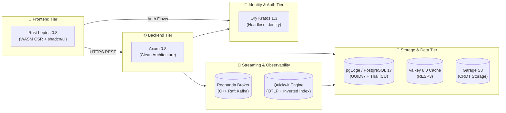

# 🛠️ Chapter 1: Technology Stack & Protocol Matrix

> [!info] Navigation
> - ⬅️ Back to: [[00_INDEX|Master Index]]
> - ➡️ Next: [[02_CLEAN_ARCHITECTURE_RUST|Clean Architecture in Rust]]

---

## 1. Overview of Technology Decisions

The platform stack is intentionally selected to maximize compiled performance, memory safety, sub-millisecond execution, and native support for geo-distributed active-active operations.

---

## 2. Detailed Stack Matrix

| Layer | Technology | Version | Wire Protocol | Internal Port | Host Port | Strategic Rationale |
| :--- | :--- | :--- | :--- | :--- | :--- | :--- |
| **Frontend** | **Rust Leptos + shadcn/ui** | 0.8.x | HTTPS | 80 / 443 | 3000 | Pure Rust WASM execution, zero JS runtime overhead, reactive fine-grained DOM updates, Tailwind CSS integration via `tailwind_fuse`. |
| **Backend API** | **Axum (Rust)** • `api-master` • `api-report` • `api-notification` | 0.8.x | HTTP/1.1, HTTP/2, SSE | 8000 (`master`) 8001 (`report`) 8002 (`notification`) | 8000 (`master`) 8001 (`report`) 8002 (`notification`) | Clean Architecture services with native Tokio integration, tower middleware ecosystem, zero-allocation routing, and real-time SSE streaming. |
| **Identity / IAM** | **Ory Kratos** | 1.3.x | HTTP REST | Public: 4433 Admin: 4434 | Public: 4433 Admin: 4434 | Headless IAM architecture, separating AuthN (Kratos) from AuthZ (Axum), native Argon2id password hashing, modern WebAuthn/passkey support. |
| **Relational Database** | **pgEdge (PostgreSQL)** | 17.x | PostgreSQL Wire | 5432 | 5432 | Native multi-master replication via Spock, support for time-ordered UUIDv7 without cross-node coordination, built-in ICU collation for Thai language. |
| **In-Memory Cache** | **Valkey** | 8.0.x | RESP2 / RESP3 | 6379 | 6379 | Open-source Redis-compatible in-memory store, fully compatible with Rust `redis` crate, sub-millisecond latency. |
| **Object Storage** | **Garage S3** | 1.1.x | S3 REST API | 3900 | 3900 | Lightweight, distributed S3 storage built in Rust with CRDT metadata synchronization across datacenters. |
| **Event Streaming** | **Redpanda** | 24.3.x | Kafka Protocol | 9092 | 9092 | C++ implementation of Kafka wire protocol, Raft consensus, zero JVM tuning, low and predictable tail latencies. |
| **Audit & Logging** | **Quickwit** | 0.8.x | REST / OTLP gRPC | REST: 7280 OTLP: 7281 | REST: 7280 OTLP: 7281 | Sub-second search engine decoupled over object storage, native OpenTelemetry trace & log receiver, Kafka indexer. |

---

## 3. Technology Evaluation & Alternatives Considered

### 3.1 Backend: Axum vs Actix-web vs Go (Gin/Fiber)
- **Choice**: **Axum 0.8**
- **Rationale**: Direct synergy with `tokio`, `tower`, and `hyper`. Axum provides macro-less extraction, compile-time route verification, and exceptional memory safety. While Actix-web is comparable in speed, Axum's alignment with the Tokio ecosystem makes clean architecture layer separation more ergonomic.

### 3.2 Relational Database: pgEdge vs CockroachDB vs YugabyteDB
- **Choice**: **pgEdge (PostgreSQL 17 + Spock)**
- **Rationale**: CockroachDB and YugabyteDB incur heavy cross-node coordination latency (Raft consensus per distributed transaction) when deployed across WAN regions. pgEdge with Spock enables **asynchronous active-active logical replication**, allowing Bangkok and Singapore to write locally at full PostgreSQL speed without waiting for cross-region quorum.

### 3.3 Identity & Auth: Ory Kratos vs Keycloak vs Casdoor
- **Choice**: **Ory Kratos 1.3**
- **Rationale**:
  - Keycloak is heavy (JVM-based, high memory consumption, complex multi-region replication).
  - Casdoor relies on synchronous database syncing which creates tight coupling between internal DB schemas and the auth server.
  - Ory Kratos is a cloud-native, headless Go binary focused purely on authentication flows (login, registration, recovery, verification), delegating authorization and business roles cleanly to the application layer.

### 3.4 Object Storage: Garage vs MinIO
- **Choice**: **Garage 1.1**
- **Rationale**: MinIO requires strict quorum-based clustering across all nodes, making WAN / multi-datacenter operation fragile and prone to split-brain locks. Garage was engineered specifically for geo-distributed deployments using CRDTs (Conflict-Free Replicated Data Types), maintaining availability even during high WAN latency or link outages.

### 3.5 Event Streaming: Redpanda vs Apache Kafka
- **Choice**: **Redpanda 24.3**
- **Rationale**: Apache Kafka requires a JVM, ZooKeeper/KRaft tuning, and significant memory overhead (typically 4GB+ per broker). Redpanda is written in C++ with a thread-per-core architecture, consuming minimal resources while providing deterministic low-latency throughput.

---

## 4. Cross-Document References

- Learn how the Rust workspace is structured: [[02_CLEAN_ARCHITECTURE_RUST]]
- Explore local deployment: [[03_SIMPLE_TOPOLOGY]]
- Explore multi-region architecture: [[04_MULTI_REGION_TOPOLOGY]]
- View the complete port allocation table: [[09_NETWORK_PORTS_AND_SECURITY_MATRIX]]
