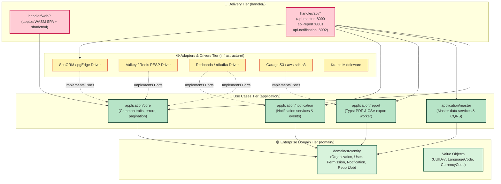

# 🦀 Chapter 2: Clean Architecture in Rust

> [!info] Navigation
> - ⬅️ Back to: [[01_STACK_OVERVIEW|Technology Stack Overview]]
> - ➡️ Next: [[03_SIMPLE_TOPOLOGY|Simple Architecture Topology]]
> - 🧭 [[00_INDEX|Master Index]]

---

## 1. The Clean Architecture Dependency Rule

In this platform, **Clean Architecture (Hexagonal / Ports & Adapters)** is strictly enforced at the compiler level using Rust's Cargo workspace structure. 

> [!important] The Invariant Dependency Rule
> **Source code dependencies must point only inward**, toward high-level business policies. Nothing in an inner circle can know anything at all about something in an outer circle.



---

## 2. Cargo Workspace Member Mapping

The root [`Cargo.toml`](file:///home/attaporn_j/Desktop/work/research/rust_arch_clean/Cargo.toml) organizes the system into 11 focused crates:

```text
rust_arch_clean/
├── Cargo.toml                                    # Root workspace manifest & dependency pinning
├── domain/                                       # 🟢 Circle 1: Domain Entities & Rules
│   ├── Cargo.toml
│   └── src/
│       ├── entity/                               # Language, Organization, User, Permission, Notification, ReportJob
│       └── lib.rs
├── application/                                  # 🔵 Circle 2: Use Cases & Business Workflows
│   ├── core/                                     # Ports (Traits), Common Errors, Pagination, Wire formats
│   ├── master/                                   # Master Data Business Services & CQRS Handlers
│   ├── report/                                   # Reporting Use Cases (CSV export worker, Typst PDF)
│   └── notification/                             # Notification Services (Ingest, SSE stream dispatch)
├── infrastructure/                               # 🟡 Circle 3: Adapters & Concrete Implementations
│   ├── Cargo.toml
│   └── src/
│       ├── services/                             # SeaORM, Valkey, Redpanda, Garage S3, Quickwit
│       ├── middleware/                           # auth/ audit/ cache/ http/ (grouped by purpose)
│       └── lib.rs
└── handler/                                      # 🔴 Circle 4: Presentation & Delivery
    ├── api/                                      # Axum REST Binaries
    │   ├── master/                               # Axum binary for Master Data Service (Port 8000)
    │   ├── report/                               # Axum binary for Report Generation & Download Service (Port 8001)
    │   └── notification/                         # Axum binary for Realtime Notification & SSE Service (Port 8002)
    └── web/                                      # Frontend WebAssembly Applications
        ├── package/                              # Shared Leptos shadcn/ui Components & Helpers
        └── application/master/                   # Leptos CSR SPA for Master Data, IAM, Reports & Notifications
```

---

## 3. Crate Responsibilities & Dependency Boundaries

### 3.1 `domain` Crate (Inner Core)
- **Role**: Contains enterprise business logic, core entities, and invariant rules.
- **Allowed Dependencies**: Only fundamental serialization and type libraries (`serde`, `uuid` with v7, `chrono`, `thiserror`).
- **Forbidden**: Must **never** import `axum`, `tokio`, `sqlx`, `sea-orm` (unless purely for schema derive macros), or HTTP clients.

### 3.2 `application/*` Crates (Use Cases)
- **Role**: Coordinates business actions. Defines **Input Ports** (Services) and **Output Ports** (Repository traits).
- **Sub-packages**:
  - `application-core`: Declares repository traits (`OrganizationRepository`, `NotificationService`, `AuditStreamPublisher`, `CacheService`).
  - `application-master`: Implements master data business operations (e.g. creating an organization/department, managing users, permissions, and menus).
  - `application-report`: Generates binary documents and CSV exports (`CsvObjectWriter`), coordinates background report jobs (`rp_report_job`).
  - `application-notification`: Ingests and processes realtime user notifications (`nt_notification`), tracks unread status, and powers SSE streaming.
- **Allowed Dependencies**: `domain`, `serde`, `async-trait`, `thiserror`, `tracing`.

### 3.3 `infrastructure` Crate (Interface Adapters)
- **Role**: Provides the concrete technical implementations of the traits defined in `application-core`.
- **Adapters Implemented**:
  - `PgEdgeOrganizationRepository` using `sea-orm` and `sqlx-postgres`.
  - `ValkeyCacheService` using `redis`.
  - `RedpandaAuditPublisher` and `RedpandaNotificationPublisher` using `rdkafka`.
  - `GarageStorageService` using `aws-sdk-s3`.
  - `KratosAuthMiddleware` using `axum-extra`, `reqwest`, and `ory-kratos-client`.

### 3.4 `handler/*` Crates (Delivery Mechanisms)
- **Role**: The entry point for incoming network requests.
- **`handler/api/*`**: Axum microservices exposing REST endpoints, translating HTTP parameters into DTOs, invoking Application use cases, and returning JSON/CBOR:
  - `api-master` (Port 8000): Master data, user accounts, IAM permissions, and system configurations.
  - `api-report` (Port 8001): Report jobs status, CSV row preview, and signed Garage S3 download links.
  - `api-notification` (Port 8002): Real-time SSE notification stream, unread counts, and mark-read actions.
- **`handler/web/*`**: Leptos CSR WebAssembly apps compiling to `.wasm` files executed inside client browsers.

---

## 4. Code Pattern: Dependency Inversion in Action

### 4.1 Port Definition in `application/core`
```rust
// application/core/src/traits/organization.rs
use async_trait::async_trait;
use domain::entity::Organization;
use uuid::Uuid;
use crate::errors::AppResult;

#[async_trait]
pub trait OrganizationRepository: Send + Sync {
    async fn find_by_id(&self, id: Uuid) -> AppResult<Option<Organization>>;
    async fn save(&self, org: &Organization) -> AppResult<()>;
}
```

### 4.2 Adapter Implementation in `infrastructure`
```rust
// infrastructure/src/services/db_organization.rs
use application_core::traits::OrganizationRepository;
use application_core::errors::AppResult;
use domain::entity::Organization;
use sea_orm::DatabaseConnection;
use async_trait::async_trait;
use uuid::Uuid;

pub struct SeaOrmOrganizationRepository {
    db: DatabaseConnection,
}

#[async_trait]
impl OrganizationRepository for SeaOrmOrganizationRepository {
    async fn find_by_id(&self, id: Uuid) -> AppResult<Option<Organization>> {
        // Query pgEdge via SeaORM...
        Ok(None)
    }

    async fn save(&self, org: &Organization) -> AppResult<()> {
        // Persist to pgEdge...
        Ok(())
    }
}
```

### 4.3 Handler Inversion in `handler/api/master`
```rust
// handler/api/master/src/main.rs
use axum::{routing::get, Router};
use std::sync::Arc;
use application_core::traits::OrganizationRepository;

struct AppState {
    org_repo: Arc<dyn OrganizationRepository>,
}

#[tokio::main]
async fn main() {
    // Infrastructure is injected into application handlers at runtime entry point!
}
```

---

## 5. Cross-Document References

- Review technology selection: [[01_STACK_OVERVIEW]]
- Explore simple single-region deployment: [[03_SIMPLE_TOPOLOGY]]
- Explore multi-region architecture: [[04_MULTI_REGION_TOPOLOGY]]
