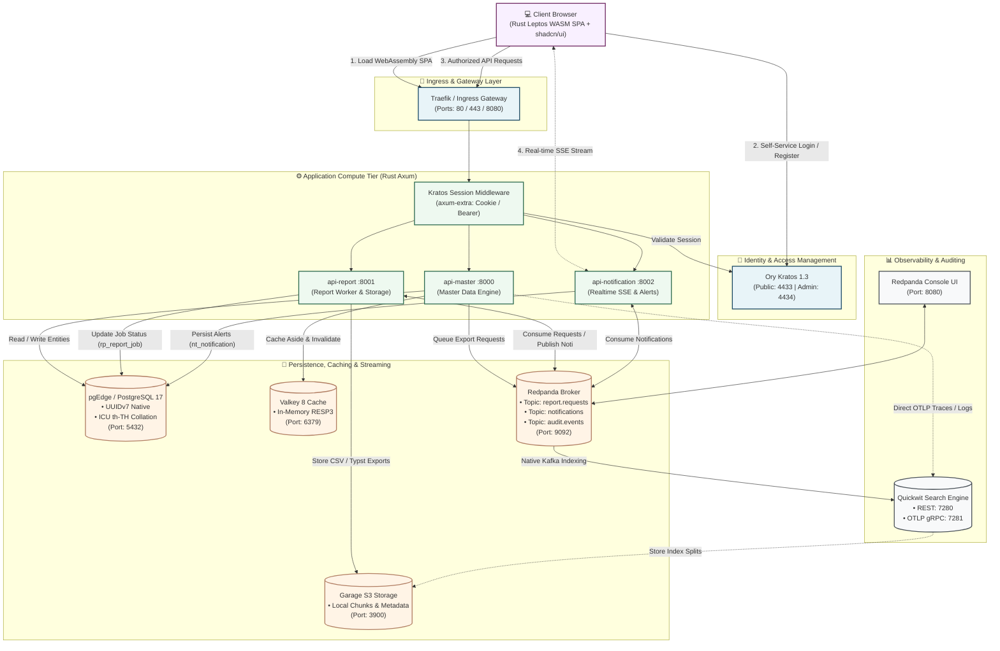
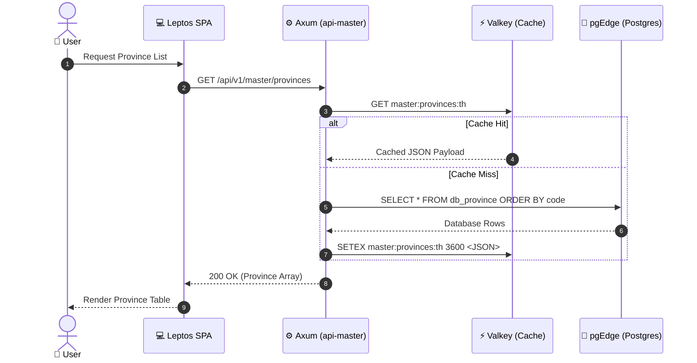
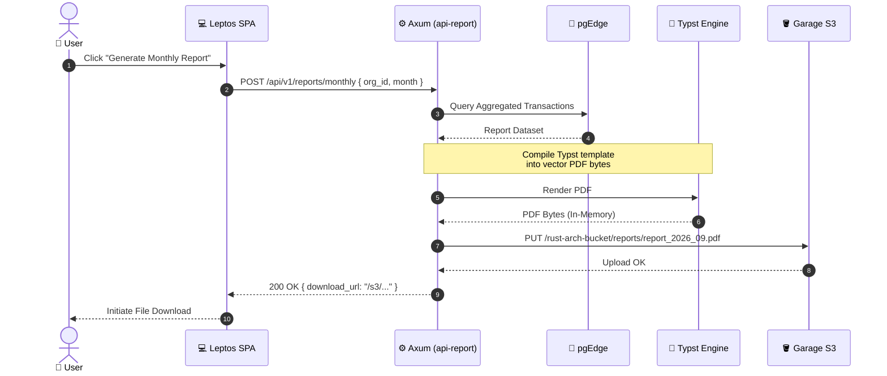
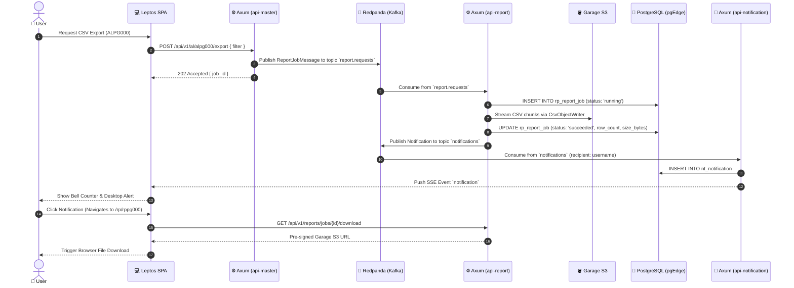

# 💻 Chapter 3: Mode 1 - Simple Single-Region Topology

> [!info] Navigation
> - ⬅️ Back to: [[02_CLEAN_ARCHITECTURE_RUST|Clean Architecture in Rust]]
> - ➡️ Next: [[04_MULTI_REGION_TOPOLOGY|Multi-Region Distributed Architecture]]
> - 🧭 [[00_INDEX|Master Index]]

---

## 1. Overview & Objectives

The **Simple Architecture** provides a self-contained, low-overhead environment running on a single Kubernetes cluster (or locally via `k3d` on rootless Podman/Docker). 

It is ideal for:
- Local development and testing.
- Single-VPC production deployments with low-to-medium traffic.
- Continuous Integration (CI) and automated end-to-end testing pipelines.

---

## 2. Architecture Diagram



---

## 3. Communication Protocols & Port Mappings

All services in the simple local architecture are bound to fixed NodePorts and exposed directly to `localhost` through the `k3d` direct server binding:

| Service | Internal DNS | NodePort | Host Port (`localhost`) | Function |
| :--- | :--- | :--- | :--- | :--- |
| **Axum API Master** | `api-master.arch.svc:8000` | - | `8000` | Master data, IAM, and menu API |
| **Axum API Report** | `api-report.arch.svc:8001` | - | `8001` | Background report worker & signed download API |
| **Axum API Notification**| `api-notification.arch.svc:8002`| - | `8002` | SSE push streaming & notification API |
| **PostgreSQL 17** | `pgedge.arch.svc:5432` | `30432` | `5432` | Relational storage (UUIDv7, ICU th-TH) |
| **Valkey 8** | `valkey.arch.svc:6379` | `30379` | `6379` | In-memory key-value cache |
| **Redpanda Kafka** | `redpanda.arch.svc:9092` | `30092` | `9092` | Event streaming broker |
| **Redpanda Admin** | `redpanda.arch.svc:9644` | `30644` | `9644` | Broker administration API |
| **Redpanda Console**| `redpanda-console.arch.svc:8080`| `30080` | `8080` | Web UI for topics, consumer groups |
| **Ory Kratos Public**| `kratos.arch.svc:4433` | `30433` | `4433` | User self-service login/signup API |
| **Ory Kratos Admin** | `kratos.arch.svc:4434` | `30434` | `4434` | Internal identity management API |
| **Garage S3** | `garage.arch.svc:3900` | `30900` | `3900` | S3-compatible object storage API |
| **Garage Admin** | `garage.arch.svc:3903` | `30903` | `3903` | Node & layout admin API |
| **Quickwit REST** | `quickwit.arch.svc:7280` | `30280` | `7280` | Search/Ingest REST & Web UI |
| **Quickwit OTLP** | `quickwit.arch.svc:7281` | `30281` | `7281` | OpenTelemetry gRPC receiver |

---

## 4. Workflows & Sequence Diagrams

### 4.1 Master Data Read Workflow (Cache-Aside Pattern)



### 4.2 Report Generation Workflow



### 4.3 Asynchronous Report Generation & Realtime Notification Push



---

## 5. Local Operations Quickstart

To run this architecture locally:

```bash
# 1. Start cluster and bootstrap all services
make bootstrap

# 2. Check pod and service status
make status

# 3. Open Kubernetes dashboard TUI
make k9s

# 4. Stream service logs
make logs APP=arch-database

# 5. Stop cluster preserving data
make stop
```

---

## 6. Cross-Document References

- Review multi-region distributed design: [[04_MULTI_REGION_TOPOLOGY]]
- Examine data consistency models: [[05_DATA_CONSISTENCY_AND_STORAGE]]
- Review identity management: [[06_SECURITY_IDENTITY_AUTH]]
