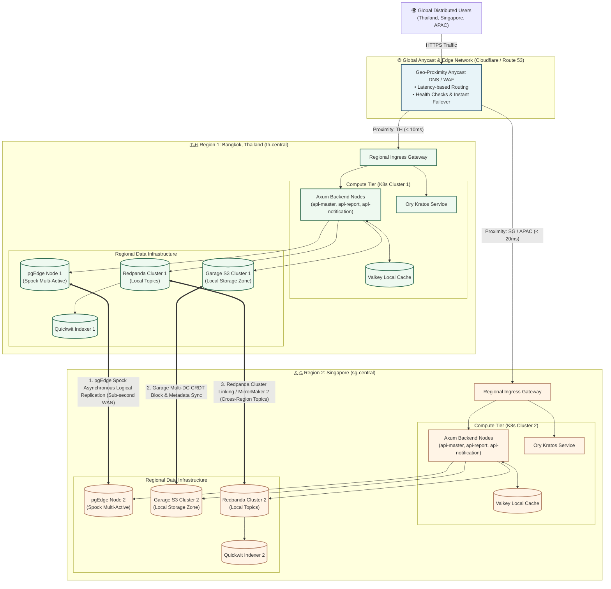

# 🌍 Chapter 4: Mode 2 - Multi-Region Active-Active Distributed Architecture

> [!info] Navigation
> - ⬅️ Back to: [[03_SIMPLE_TOPOLOGY|Simple Architecture Topology]]
> - ➡️ Next: [[05_DATA_CONSISTENCY_AND_STORAGE|Data Consistency & Storage Strategies]]
> - 🧭 [[00_INDEX|Master Index]]

---

## 1. Multi-Region Design Goals

The **Multi-Region Architecture** operates concurrently across geographically disparate cloud regions (e.g., **Region 1: Bangkok / TH** and **Region 2: Singapore / SG**).

```text
┌──────────────────────────────────────────────────────────────────────────────┐
│                       MULTI-REGION SERVICE OBJECTIVES                        │
├────────────────────────────┬─────────────────────────────────────────────────┤
│ Recovery Time Obj (RTO)    │ ≈ 0 seconds (Immediate Anycast failover)        │
│ Recovery Point Obj (RPO)   │ < 1.0 second (Sub-second Spock & CRDT sync)    │
│ Write Availability         │ 100% Local (Active-Active, No Global 2PC Lock)  │
│ Key Collision Freedom      │ Guaranteed mathematically via UUIDv7            │
│ Regional Latency           │ < 15ms TTFB for local users                     │
└────────────────────────────┴─────────────────────────────────────────────────┘
```

---

## 2. Multi-Region Topology Diagram



---

## 3. Global Ingress & Traffic Management

1. **Anycast Border Routing**:
   - Clients resolve `app.arch.example.com` to Anycast IPs announced by Cloudflare / AWS Route 53.
   - BGP routing directs traffic to the closest geographical point of presence (PoP).
2. **Health Check Probing & Automatic Divert**:
   - Edge probes evaluate HTTP `/healthz` on both regional gateways every 5 seconds.
   - If Region 1 fails, edge routing flips 100% of incoming traffic to Region 2 in < 5 seconds without manual DNS TTL propagation delays.
3. **Leptos WASM Distribution**:
   - Frontend static assets (`.wasm`, `.js`, CSS, assets) are cached at edge PoPs globally, reducing cold-start latency.

---

## 4. Cross-Region Data Synchronization Channels

### Channel 1: Relational Data via pgEdge (Spock)
- **Protocol**: Logical Replication Protocol over TLS (PostgreSQL Wire Port 5432).
- **Latency Impact**: Zero on the write path! Axum commits locally to `DB1`. Spock reads the WAL asynchronously and ships changes to `DB2` in < 200ms.
- **Collision Immunity**: Tables use UUIDv7 generated in application memory. Both regions write simultaneously without colliding keys.

### Channel 2: Object Storage via Garage (CRDT)
- **Protocol**: Garage Inter-Node RPC Protocol over TLS (Port 3902).
- **Latency Impact**: Files uploaded in Bangkok are immediately written to local NVMe disks in `Garage1`. Chunks and Merkle tree roots sync to Singapore asynchronously.

### Channel 3: Event Streams via Redpanda (Cluster Linking)
- **Protocol**: Kafka Wire Protocol over mTLS (Port 9092).
- **Replication Model**: Local topic `audit.events.bkk` mirrors to Singapore as `audit.events.bkk.remote`. A consumer in either region can read the union stream.

---

## 5. Failure Scenarios & Network Partitioning

### Scenario A: Total Loss of Region 1 (Bangkok DC Down)
1. Anycast edge detects Region 1 failure in < 5s and routes all traffic to Region 2 (Singapore).
2. Region 2 already possesses:
   - Full copy of all relational data replicated up to the last 200ms.
   - All user identities in Ory Kratos.
   - All S3 files in Garage.
3. Users continue logging in and transacting against Region 2 without intervention.

### Scenario B: Submarine Cable Cut (Network Partition between TH & SG)
- **Behavior**:
  - Both regions continue operating as standalone active clusters.
  - Thai users write to Bangkok; Singapore users write to Singapore.
  - UUIDv7 guarantees zero ID collisions during the split.
- **Reconciliation upon Cable Restoration**:
  - Spock applies buffered logical change logs using **Last-Update-Wins (LUW)** based on commit timestamps.
  - Garage compares Merkle trees and pulls missing object blocks.
  - Redpanda catches up mirrored topic offsets.

---

## 6. Cross-Document References

- Deep dive into Spock & UUIDv7 consistency: [[05_DATA_CONSISTENCY_AND_STORAGE]]
- Learn about distributed identity with Ory Kratos: [[06_SECURITY_IDENTITY_AUTH]]
- Review disaster recovery procedures: [[08_DISASTER_RECOVERY_AND_RESILIENCY]]
