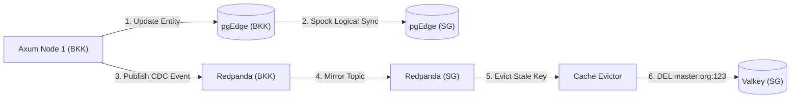

# 💾 Chapter 5: Data Consistency & Storage Strategies

> [!info] Navigation
> - ⬅️ Back to: [[04_MULTI_REGION_TOPOLOGY|Multi-Region Distributed Architecture]]
> - ➡️ Next: [[06_SECURITY_IDENTITY_AUTH|Identity, Authentication & Permissions]]
> - 🧭 [[00_INDEX|Master Index]]

---

## 1. The Multi-Region Consistency Model

```text
┌──────────────────────────────────────────────────────────────────────────────┐
│                    DISTRIBUTED CONSISTENCY SPECIFICATIONS                    │
├────────────────────┬──────────────────┬──────────────────────────────────────┤
│ Component          │ Consistency Type │ Replication Mechanism                │
├────────────────────┼──────────────────┼──────────────────────────────────────┤
│ pgEdge (Postgres)  │ Eventual / Causal│ Spock 3.x Multi-Master Logical Rep   │
│ Garage S3          │ Strong Eventual  │ State-based CRDTs + Merkle Trees     │
│ Redpanda (Local)   │ Strict           │ Raft Consensus per Cluster           │
│ Redpanda (Cross-DC)│ Eventual         │ Asynchronous Cluster Linking         │
│ Valkey             │ Local Only       │ Regional Cache (Invalidated via CDC) │
│ Ory Kratos         │ Eventual / Causal│ Backed by pgEdge Spock Sync          │
└────────────────────┴──────────────────┴──────────────────────────────────────┘
```

---

## 2. pgEdge & Spock Multi-Master Replication

### 2.1 Why Spock Over Physical Replication
Standard PostgreSQL physical streaming replication is **single-master (active-passive)**. Replicas are read-only and cannot accept write transactions. Furthermore, physical WAL replication requires identical hardware architectures and storage blocks.

**Spock 3.x** implements **asynchronous logical multi-master replication**:
- Every regional node is an independent, writable PostgreSQL instance.
- Table changes are decoded logically into row-level operations (INSERT, UPDATE, DELETE) and transmitted across WAN links to peer nodes.
- Local writes complete in sub-millisecond local disk commit time without waiting for remote nodes.

### 2.2 Conflict Detection & Resolution (CDR)
When two users update the same row concurrently in Bangkok and Singapore:
1. **Timestamp-Based Last-Update-Wins (LUW)**: Spock compares microsecond commit timestamps embedded in the replication stream. The most recent commit wins.
2. **Optimistic Locking via `row_version`**:
   Clean Architecture entities include a `row_version bigint NOT NULL DEFAULT 1` column.
   ```sql
   UPDATE db_department 
      SET name = $1, row_version = row_version + 1 
    WHERE id = $2 AND row_version = $3;
   ```
   If another transaction incremented `row_version`, the query returns 0 rows updated, prompting the application to retry.

   **How the code does it (one place):** every edit form sends back the `row_version` it loaded, and every update command saves through
   `application_master::features::optimistic_update::update_versioned(&txn, active_model, (Entity::Column::Id, Entity::Column::RowVersion), id, cmd.row_version)`.
   It issues the single conditional `UPDATE` above (the caller sets only the changed columns; it neither compares nor adds the version, and a `row_version` it sets is ignored).
   No matching row ⇒ `DbErr::RecordNotUpdated`, which each feature's `From<DbErr>` turns into its `VersionConflict`, and the router answers **412 `VERSION_CONFLICT`**
   ("Data has been modified by another transaction. Please reload and try again."). Because the check is the `WHERE` clause, two saves at the same moment cannot both win.
   Write the main row first inside the transaction, so a conflict rolls back the child rows (labels, assignments) too.
   Two saves are not single rows: the SUPG003 matrix is versioned by its group (`su_permission_group.row_version`, bumped only when the matrix changes), and a DBPG006 label entry by the sum of its translations' versions.
   Updates that deliberately keep the version (images, contact group link, `must_change_password`) do not go through the helper, so an open form can still be saved.

---

## 3. Mathematical Collision Freedom: UUIDv7

To enable concurrent inserts across multiple active-active regions without central sequence coordination, the platform mandates **UUIDv7 (RFC 9562)** for all primary keys.

### 3.1 Bit Layout of UUIDv7

```text
 0                   1                   2                   3
 0 1 2 3 4 5 6 7 8 9 0 1 2 3 4 5 6 7 8 9 0 1 2 3 4 5 6 7 8 9 0 1
+-+-+-+-+-+-+-+-+-+-+-+-+-+-+-+-+-+-+-+-+-+-+-+-+-+-+-+-+-+-+-+-+
|                           unix_ts_ms                          | (48 bits)
+-+-+-+-+-+-+-+-+-+-+-+-+-+-+-+-+-+-+-+-+-+-+-+-+-+-+-+-+-+-+-+-+
|          unix_ts_ms           |  ver  |       rand_a          | (16 bits)
+-+-+-+-+-+-+-+-+-+-+-+-+-+-+-+-+-+-+-+-+-+-+-+-+-+-+-+-+-+-+-+-+
|var|                        rand_b                             | (64 bits)
+-+-+-+-+-+-+-+-+-+-+-+-+-+-+-+-+-+-+-+-+-+-+-+-+-+-+-+-+-+-+-+-+
```

### 3.2 Advantages over UUIDv4 and BigSerial
1. **Time-Ordered Monotonic Locality**: Unlike UUIDv4 (pure random), UUIDv7 values sort chronologically. When inserted into PostgreSQL B-Tree indexes, new rows append to the right edge of the tree rather than fragmenting random index pages across disk.
2. **Zero Global Coordination**: Unlike `BIGSERIAL` or distributed sequences (Twitter Snowflake), UUIDv7 requires no network calls to a sequencer. Keys generated in Bangkok and Singapore are guaranteed to never collide due to the 74 bits of entropy.

In Rust:
```rust
use uuid::Uuid;

// Generates time-ordered UUIDv7 in application memory
let entity_id = Uuid::now_v7();
```

---

## 4. Thai Language Support (ICU Collation)

### 4.1 The Challenge of Thai Text
Thai script is written without spaces between words, and vowel characters can precede the initial consonant phonetically (e.g. `เ-`, `แ-`, `โ-`, `ใ-`, `ไ-`). Under standard binary sorting (`ASCII` or `C`), characters are sorted by byte code, causing words starting with vowels to sort in the wrong order.

### 4.2 ICU Provider Configuration
PostgreSQL 17 is initialized with the native **ICU (International Components for Unicode)** provider:
```bash
POSTGRES_INITDB_ARGS="--locale-provider=icu --icu-locale=th-TH"
```

In table definitions:
```sql
CREATE TABLE "db_language_label" (
  "language_id" uuid NOT NULL,
  "display_language_id" uuid NOT NULL,
  "label" text COLLATE "th-TH-x-icu" NOT NULL,
  PRIMARY KEY ("language_id", "display_language_id")
);
```

### 4.3 Determinism Across Regions
Because the collation rules are driven by the ICU library and versioned (`th-TH-x-icu`), indexes on both Bangkok and Singapore nodes produce identical sort orders regardless of the host OS Linux distribution.

---

## 5. Garage S3 Object Storage & CRDTs

### 5.1 Architecture of Garage
Garage is a lightweight, distributed S3 storage system written in Rust:
- **No Global Consensus on Read/Write**: Garage does not run Raft across the WAN.
- **CRDT Version Vectors**: Object metadata (keys, versions, delete markers) is modeled as Conflict-Free Replicated Data Types. Concurrent uploads to the same key are merged deterministically.
- **Chunking & Deduplication**: Files are split into SHA-256 deduplicated content blocks. Only missing blocks are synchronized across the WAN.

---

## 6. Valkey Regional Cache Invalidation



---

## 7. Cross-Document References

- Review multi-region overview: [[04_MULTI_REGION_TOPOLOGY]]
- Review security & IAM architecture: [[06_SECURITY_IDENTITY_AUTH]]
- Review event streaming with Redpanda: [[07_EVENT_STREAMING_OBSERVABILITY]]
- Review read cache & invalidation: [[11_VALKEY_READ_CACHE]]
