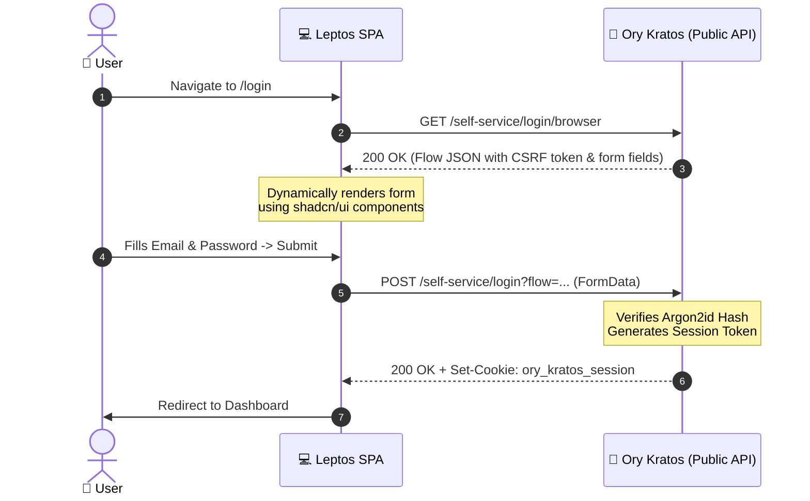
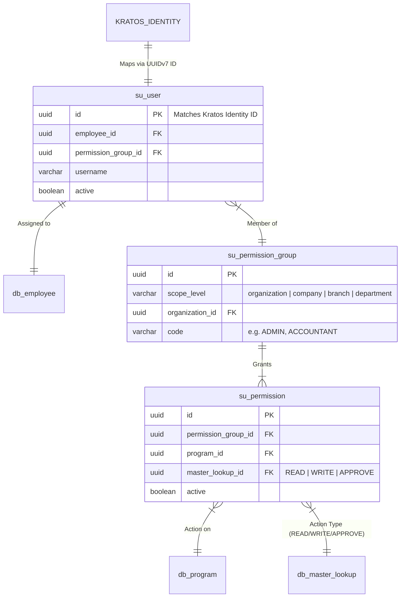

# 🔐 Chapter 6: Identity, Authentication & Permissions

> [!info] Navigation
> - ⬅️ Back to: [[05_DATA_CONSISTENCY_AND_STORAGE|Data Consistency & Storage Strategies]]
> - ➡️ Next: [[07_EVENT_STREAMING_OBSERVABILITY|Event Streaming & Observability]]
> - 🧭 [[00_INDEX|Master Index]]

---

## 1. Clean Separation: AuthN vs AuthZ

The platform enforces a strict architectural boundary between **Authentication (AuthN)** and **Authorization (AuthZ)**:

```text
┌────────────────────────────────────────┐       ┌────────────────────────────────────────┐
│     AUTHENTICATION (AuthN) - ORY KRATOS │       │    AUTHORIZATION (AuthZ) - AXUM & DB   │
├────────────────────────────────────────┤       ├────────────────────────────────────────┤
│ • Headless Identity Store              │       │ • Domain Permissions Engine            │
│ • User Credentials (Argon2id)          │       │ • Multi-Tier Scopes (Org/Company/Dept) │
│ • Login, Registration, MFA Flows       │       │ • RBAC & ABAC Policy Enforcement       │
│ • Session Cookie & Token Issuance      │       │ • User-to-Employee Mapping (`su_user`) │
│ • Account Verification & Recovery      │       │ • Program Action Checks (Read/Write)   │
└────────────────────────────────────────┘       └────────────────────────────────────────┘
```

---

## 2. Ory Kratos Architecture & Flows

### 2.1 Headless Self-Service Pattern
Ory Kratos does **not** render server-side HTML pages. It provides HTTP APIs that return JSON payloads containing UI form schemas. The **Rust Leptos WASM SPA** dynamically renders form inputs, CSRF tokens, and validation messages based on Kratos JSON responses.



### 2.2 Argon2id Parameter Specification
Kratos uses the OWASP-recommended Argon2id parameters:
- **Algorithm**: `argon2id` (Version 19)
- **Memory Cost ($m$)**: `19456 KiB` (19 MiB)
- **Time Cost ($t$)**: `2` iterations
- **Parallelism ($p$)**: `1` lane

---

## 3. Session Verification in Axum Middleware

### 3.1 Middleware Execution Flow
1. Incoming HTTP requests pass through `KratosAuthMiddleware`.
2. The middleware extracts the `ory_kratos_session` cookie (or `Authorization: Bearer <token>` header).
3. The middleware issues a sub-millisecond local HTTP request to `GET http://kratos:4433/sessions/whoami` with the forwarded cookie.
4. If valid, Kratos returns the identity payload:
   ```json
   {
     "id": "019ca1ec-0000-7000-8010-000000000001",
     "active": true,
     "traits": {
       "email": "admin@arch.local",
       "name": { "first": "ผู้ดูแล", "last": "ระบบ" }
     }
   }
   ```
5. Axum injects an `AuthenticatedUser` struct into request extensions, making the actor available to all subsequent handlers.

### 3.2 Axum Middleware Code Pattern
```rust
// infrastructure/src/middleware/auth.rs
use axum::{
    extract::Request,
    middleware::Next,
    response::Response,
    http::StatusCode,
};
use axum_extra::extract::CookieJar;

pub async fn kratos_auth_middleware(
    jar: CookieJar,
    mut req: Request,
    next: Next,
) -> Result<Response, StatusCode> {
    let session_cookie = jar.get("ory_kratos_session")
        .ok_or(StatusCode::UNAUTHORIZED)?;

    // Call Kratos /sessions/whoami...
    let client = reqwest::Client::new();
    let res = client.get("http://kratos:4433/sessions/whoami")
        .header("Cookie", format!("ory_kratos_session={}", session_cookie.value()))
        .send()
        .await
        .map_err(|_| StatusCode::INTERNAL_SERVER_ERROR)?;

    if res.status().is_success() {
        // Attach user context to request extensions
        Ok(next.run(req).await)
    } else {
        Err(StatusCode::UNAUTHORIZED)
    }
}
```

---

## 4. Permission Model & Database Hierarchy

Identity in Kratos is mapped to the internal database authorization tables:



---

## 5. Cross-Document References

- Review relational database storage: [[05_DATA_CONSISTENCY_AND_STORAGE]]
- Review event streaming for audit logs: [[07_EVENT_STREAMING_OBSERVABILITY]]
- Review network port matrix: [[09_NETWORK_PORTS_AND_SECURITY_MATRIX]]
