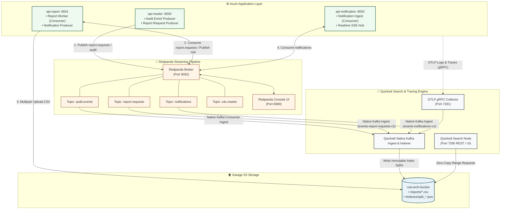

# 📡 Chapter 7: Event Streaming & Observability

> [!info] Navigation
> - ⬅️ Back to: [[06_SECURITY_IDENTITY_AUTH|Identity, Authentication & Permissions]]
> - ➡️ Next: [[08_DISASTER_RECOVERY_AND_RESILIENCY|Disaster Recovery & Resiliency]]
> - 🧭 [[00_INDEX|Master Index]]

---

## 1. Streaming & Observability Architecture



---

## 2. Redpanda Event Streaming

### 2.1 The Thread-Per-Core Advantage
Unlike traditional Apache Kafka implementations running on the Java Virtual Machine (JVM), Redpanda is engineered in C++ using the Seastar async framework:
- **Zero Garbage Collection (GC) Pauses**: Guarantees consistent p99 latencies (< 5ms) under heavy write load.
- **Direct I/O**: Bypasses the Linux page cache, writing directly to disk with kernel `io_uring`.
- **Built-in Raft Consensus**: Removes ZooKeeper/KRaft dependencies.

### 2.2 Standard Topic Topologies
1. `report.requests`:
   - Carries asynchronous report generation jobs (`ReportJobMessage`). Keyed by `job_id`.
   - Dispatched by `api-master` (e.g. ALPG000 CSV export) and consumed by `api-report` (`report-worker` group).
   - Indexed continuously into Quickwit via `events-report-requests-v1`.
2. `notifications`:
   - System and user alerts (`Notification` payload). Keyed by recipient `username`.
   - Dispatched by services (e.g. `api-report` on report completion) and consumed by `api-notification`.
   - Indexed continuously into Quickwit via `events-notifications-v1`.
3. `audit.events`:
   - Stores immutable audit logs of all business actions (who, what, when, old values, new values).
   - Retained for 30 days in Redpanda; persisted indefinitely in Quickwit/S3.
4. `cdc.master`:
   - Captures database change events for cross-region cache eviction in Valkey.

---

## 3. Quickwit Search Engine & Storage Decoupling

### 3.1 Decoupled Indexing & Querying
Quickwit replaces resource-heavy Elasticsearch/OpenSearch clusters:
- **Stateless Search Nodes**: Quickwit searchers do not hold local replicas. They query immutable index splits directly from Garage S3 using HTTP Range requests.
- **Index Split Format (`.qws`)**: Columnar data format with embedded Tantivy inverted indexes, bitmaps, and Fast Field columnar caches.

### 3.2 Ingestion Pipelines & Event Indexing
1. **Streaming Kafka Sources (Audit & Events)**:
   Quickwit polls Redpanda topics natively as a consumer group, batches messages, and creates immutable index files directly on S3:
   - `events-report-requests-v1` ➔ Topic `report.requests` (timestamp: `requested_at`)
   - `events-notifications-v1` ➔ Topic `notifications` (timestamp: `created_at`)
   - Config manifests in `kube/arch/applications/arch_logging/indexes/`, provisioned via `make topics` / `make event-indexes`.
2. **Direct OTLP Pipeline (Application Traces & Logs)**:
   Axum services push OpenTelemetry spans and log events directly over gRPC to Quickwit's OTLP receiver on port `7281`.

---

## 4. Rust Tracing Instrumentation

In the Rust codebase, tracing is configured to multiplex between local stdout and remote OTLP export:

```rust
// infrastructure/src/services/logging.rs
use tracing_subscriber::{layer::SubscriberExt, util::SubscriberInitExt, EnvFilter};
use opentelemetry_otlp::WithExportConfig;

pub fn init_observability() {
    let tracer = opentelemetry_otlp::new_pipeline()
        .tracing()
        .with_exporter(
            opentelemetry_otlp::new_exporter()
                .tonic()
                .with_endpoint("http://quickwit:7281"),
        )
        .install_batch(opentelemetry_sdk::runtime::Tokio)
        .expect("Failed to initialize OTLP tracer");

    let telemetry_layer = tracing_opentelemetry::layer().with_tracer(tracer);

    tracing_subscriber::registry()
        .with(EnvFilter::from_default_env())
        .with(tracing_subscriber::fmt::layer())
        .with(telemetry_layer)
        .init();
}
```

---

## 5. Cross-Document References

- Review tech stack options: [[01_STACK_OVERVIEW]]
- Review multi-region data replication: [[05_DATA_CONSISTENCY_AND_STORAGE]]
- Review disaster recovery procedures: [[08_DISASTER_RECOVERY_AND_RESILIENCY]]
