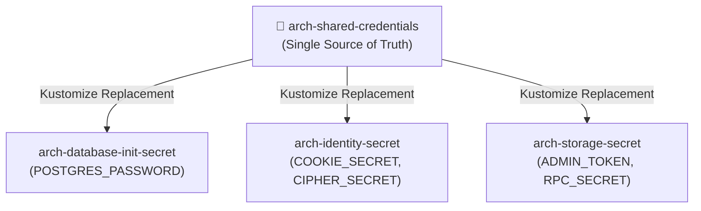

# 🔌 Chapter 9: Network, Ports & Security Matrix

> [!info] Navigation
> - ⬅️ Back to: [[08_DISASTER_RECOVERY_AND_RESILIENCY|Disaster Recovery & Resiliency]]
> - 🧭 [[00_INDEX|Master Index]]

---

## 1. Complete Port & Service Registry

This table lists all network listeners across the platform, including internal cluster DNS, k3d NodePorts, host mappings, and authentication mechanisms:

| Component | In-Cluster DNS | Container Port | NodePort (k3d) | Host Port | Protocol | Auth & Security Level |
| :--- | :--- | :--- | :--- | :--- | :--- | :--- |
| **Traefik HTTP** | `traefik.kube-system` | 80 | - | 80 / 8080 | HTTP/1.1 | Public Gateway (WAF protected) |
| **Traefik HTTPS** | `traefik.kube-system` | 443 | - | 443 / 8443 | HTTP/2, TLS | TLS 1.3 Terminated |
| **Axum API Master** | `api-master.arch.svc` | 8000 | - | - | HTTP REST | Kratos Session Cookie / Bearer Token |
| **Axum API Report** | `api-report.arch.svc` | 8001 | - | - | HTTP REST + Redpanda consumer (`report.requests`) | Kratos Session Cookie / Bearer Token |
| **Axum API Notification** | `api-notification.arch.svc` | 8002 | - | - | HTTP REST + SSE + Redpanda consumer (`notifications`) | Kratos Session Cookie / Bearer Token |
| **pgEdge / Postgres**| `pgedge.arch.svc` | 5432 | 30432 | 5432 | PostgreSQL Wire | SCRAM-SHA-256 / SSL Client Cert |
| **Valkey Cache** | `valkey.arch.svc` | 6379 | 30379 | 6379 | RESP2 / RESP3 | Isolated NetworkPolicy (Backend only) |
| **Redpanda Kafka** | `redpanda.arch.svc` | 9092 / 19092 | 30092 | 9092 | Kafka Protocol | SASL_PLAINTEXT (Dev) / SASL_SSL (Prod) |
| **Redpanda Admin** | `redpanda.arch.svc` | 9644 | 30644 | 9644 | HTTP REST | Basic Auth / Admin Token |
| **Redpanda Console**| `redpanda-console.arch.svc`| 8080 | 30080 | 8080 | HTTP Web UI | Basic Auth / Reverse Proxy Protected |
| **Ory Kratos Public**| `kratos.arch.svc` | 4433 | 30433 | 4433 | HTTP REST | Public Self-Service API (CORS enabled) |
| **Ory Kratos Admin** | `kratos.arch.svc` | 4434 | 30434 | 4434 | HTTP REST | Internal Cluster Only (Denied to Public) |
| **Garage S3 API** | `garage.arch.svc` | 3900 | 30900 | 3900 | S3 REST | AWS SigV4 HMAC Key / Secret |
| **Garage RPC** | `garage.arch.svc` | 3902 | - | - | Custom RPC | Garage Shared Cluster Secret (mTLS) |
| **Garage Admin API** | `garage.arch.svc` | 3903 | 30903 | 3903 | HTTP REST | Bearer Admin Token |
| **Quickwit REST / UI**| `quickwit.arch.svc` | 7280 | 30280 | 7280 | HTTP REST / UI | Internal Cluster / Bastion Ingress |
| **Quickwit OTLP gRPC**| `quickwit.arch.svc` | 7281 | 30281 | 7281 | gRPC OTLP | mTLS / In-Cluster Private Network |

---

## 2. Cross-Region WAN Firewall Allowlist

When deploying across multiple physical or cloud regions (e.g. Bangkok to Singapore), the following network conduits must be allowed through perimeter firewalls:

```text
┌──────────────────────────────────────────────────────────────────────────────┐
│                    CROSS-REGION WAN FIREWALL PERMIT RULES                    │
├──────────────┬──────────────┬───────────────┬────────────────────────────────┤
│ Source       │ Destination  │ Port / Proto  │ Purpose                        │
├──────────────┼──────────────┼───────────────┼────────────────────────────────┤
│ Region 1 DB  │ Region 2 DB  │ 5432 / TCP    │ pgEdge Spock Logical Rep (TLS) │
│ Region 2 DB  │ Region 1 DB  │ 5432 / TCP    │ pgEdge Spock Logical Rep (TLS) │
│ Region 1 S3  │ Region 2 S3  │ 3902 / TCP    │ Garage Inter-DC CRDT Sync(mTLS)│
│ Region 2 S3  │ Region 1 S3  │ 3902 / TCP    │ Garage Inter-DC CRDT Sync(mTLS)│
│ Region 1 RP  │ Region 2 RP  │ 9092 / TCP    │ Redpanda Cluster Linking (mTLS)│
│ Region 2 RP  │ Region 1 RP  │ 9092 / TCP    │ Redpanda Cluster Linking (mTLS)│
└──────────────┴──────────────┴───────────────┴────────────────────────────────┘
```

---

## 3. Kubernetes NetworkPolicy Specifications

To enforce zero-trust isolation within the Kubernetes namespace `arch`:

```yaml
# Default deny all ingress traffic into namespace
apiVersion: networking.k8s.io/v1
kind: NetworkPolicy
metadata:
  name: default-deny-all
  namespace: arch
spec:
  podSelector: {}
  policyTypes:
    - Ingress
---
# Allow Axum API to reach Database, Cache, Storage, and Streaming
apiVersion: networking.k8s.io/v1
kind: NetworkPolicy
metadata:
  name: allow-axum-to-backends
  namespace: arch
spec:
  podSelector:
    matchLabels:
      app.kubernetes.io/name: arch-api
  ingress: []
  egress:
    - to:
        - podSelector:
            matchLabels:
              app.kubernetes.io/name: arch-database
        - podSelector:
            matchLabels:
              app.kubernetes.io/name: arch-cache
        - podSelector:
            matchLabels:
              app.kubernetes.io/name: arch-storage
        - podSelector:
            matchLabels:
              app.kubernetes.io/name: arch-streaming
```

---

## 4. Secret Fan-Out Architecture

Following the design established in `smart-trade-kube`, sensitive credentials are centrally declared in `shared-credentials-secret.yaml` and fanned out via Kustomize `replacements` to eliminate configuration drift:



---

## 5. Cross-Document References

- Return to Master Index: [[00_INDEX]]
- Review single-region local mappings: [[03_SIMPLE_TOPOLOGY]]
- Review multi-region cross-WAN topologies: [[04_MULTI_REGION_TOPOLOGY]]
