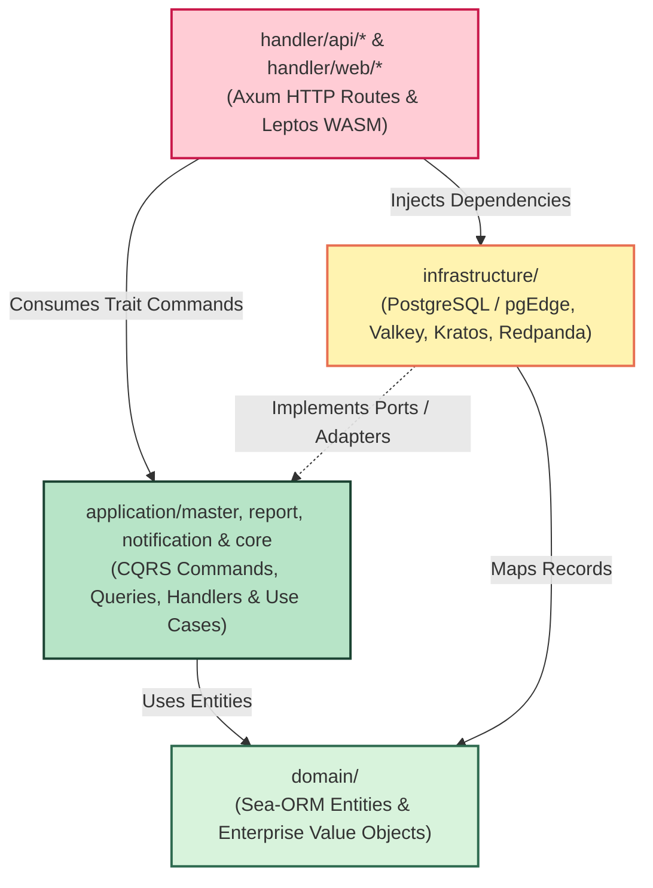
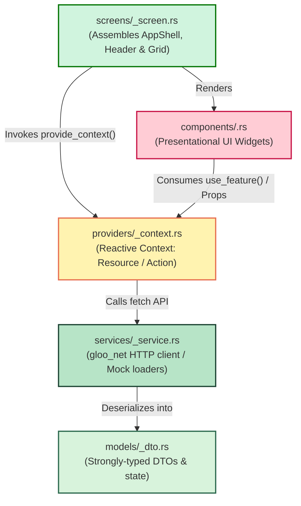
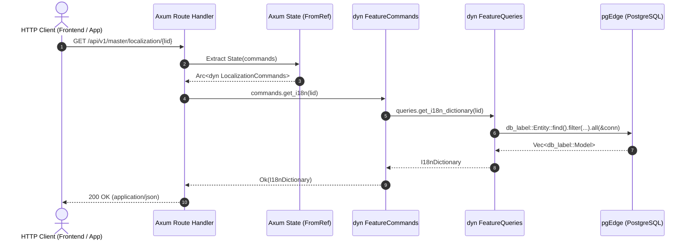

# 📐 Chapter 10: Project Structure, CQRS & Code Style Guide

> [!info] Navigation
> - ⬅️ Back to: [[09_NETWORK_PORTS_AND_SECURITY_MATRIX|Network & Security Matrix]]
> - ➡️ Next: [[11_VALKEY_READ_CACHE|Valkey Read Cache & Invalidation]]
> - 🧭 [[00_INDEX|Master Index]]
> - 🤖 Agent Entrypoint: `AGENTS.md` (Project Root)

---

## 1. Architectural Philosophy & Layer Boundaries

The codebase adheres strictly to **Clean Architecture** and **Ports & Adapters (Hexagonal)** principles. The dependency flow is unidirectionally inward:



### Layer Rules
| Layer | Location | Allowed Dependencies | Forbidden Dependencies |
| :--- | :--- | :--- | :--- |
| **Domain** | `domain/` | `serde`, `uuid`, `chrono`, `thiserror`, `sea-orm` (entities only) | `axum`, `tokio`, HTTP clients, any application/infra crate |
| **Application** | `application/*` | `domain`, `serde`, `async-trait`, `thiserror`, `tracing`, `sea-orm` (queries) | `handler/*`, `infrastructure/*`, `axum` |
| **Infrastructure** | `infrastructure/` | `domain`, `application-core`, driver crates (`redis`, `rdkafka`, `aws-sdk-s3`, `ory-kratos-client`) | Concrete feature crates (`application-master`, `application-report`, `application-notification`), `handler/*` |
| **Delivery / Handler** | `handler/api/*`, `handler/web/*` | `domain`, `application-*`, `infrastructure`, `axum`, `leptos` | Direct SQL string execution outside adapters |

---

## 2. Feature Structure (CQRS Pattern)

All business domain features inside `application/<service>/src/features/<feature>/` follow a strictly structured CQRS (Command Query Responsibility Segregation) layout:

```text
application/<service>/src/features/<feature>/
├── mod.rs                        # Feature scope definition, trait re-exports
├── errors/
│   └── mod.rs                    # Feature-specific error enum (thiserror)
├── models/
│   ├── mod.rs                    # Re-exports domain entities & feature DTOs
│   └── <model_name>.rs           # Specialized structs (e.g. I18nDictionary)
├── commands/
│   ├── mod.rs                    # Command traits (e.g. FeatureCommands)
│   ├── <action>_<target>.rs      # Specific Command struct & Handler
│   └── <feature>_executor.rs     # Executor implementing Command trait
└── queries/
    ├── mod.rs                    # Query traits (e.g. FeatureQueries)
    ├── <action>_<target>.rs      # Specific Query struct & Handler
    └── <target>_queries.rs       # Direct Sea-ORM query runner
```

### 2.1 File Naming: Strict Ban on Generic Names
> [!caution] Forbidden Generic File Names
> Never name files `service.rs`, `manager.rs`, `handler.rs`, or `utils.rs`.
> File names must immediately and self-evidently convey **what domain entity they interact with and what action they perform**:
> - ✅ `db_label_queries.rs` (Queries executing against the `db_label` table)
> - ✅ `i18n_executor.rs` (Executes i18n commands)
> - ❌ `service.rs` (Generic, ambigious)

### 2.2 Direct Sea-ORM Queries (No Unnecessary Repositories)
> [!tip] Pragmatic CQRS
> When read queries can be expressed cleanly with Sea-ORM entities (`db_<table_name>::Entity::find()`), do **NOT** introduce a separate repository layer. Implement query execution directly within the feature's `queries/<target>_queries.rs` file.

---

## 3. Frontend Feature Structure (Clean UI Pattern)

All page features inside `handler/web/application/<service>/src/pages/<feature>/` follow a strictly structured 5-layer **Clean UI Pattern**:

```text
handler/web/application/<app>/src/pages/<feature>/
├── mod.rs                        # Feature entrypoint: pub use screens::<feature>_screen::<Feature>Screen as <Feature>Page;
├── models/                       # Page DTOs, ViewModels, and state structs
│   ├── mod.rs
│   └── <feature>_dto.rs
├── services/                     # HTTP API callers, env detectors, mock data services
│   ├── mod.rs
│   └── <feature>_service.rs
├── providers/                    # Reactive Leptos Context providers & hooks (provide_context / use_context)
│   ├── mod.rs
│   └── <feature>_context.rs
├── components/                   # Presentational, reusable UI widgets isolated to this feature
│   ├── mod.rs
│   └── <widget_name>.rs
└── screens/                      # Screen orchestrator (page layout, AppShell, responsive grid, error boundary)
    ├── mod.rs
    └── <feature>_screen.rs
```



### 3.1 Layer Responsibilities & Naming Rules
| Submodule | Responsibility | Naming Convention & Example |
| :--- | :--- | :--- |
| **`models/`** | Strongly typed DTOs and view models. Derives `Clone, Debug, PartialEq, Serialize, Deserialize`. | `<feature>_dto.rs` (e.g. `dashboard_dto.rs`, `demo_models.rs`) |
| **`services/`** | HTTP communication (`gloo_net::http::Request`), mock data generation, environment detection. | `<feature>_service.rs`, `<feature>_env.rs` (e.g. `dashboard_service.rs`, `demo_env.rs`) |
| **`providers/`** | Reactive Leptos context providers and hooks. Handles state lifting and `Resource` triggers. | `<feature>_context.rs` (e.g. `dashboard_context.rs`, `demo_context.rs`) |
| **`components/`** | Presentational / "Dumb" UI components. Focuses on rendering markup and emitting events. | `<widget_name>.rs` (e.g. `kpi_cards.rs`, `module_table.rs`, `button_showcase.rs`) |
| **`screens/`** | Screen-level composition container integrating `AppShell`, breadcrumbs, responsive grids, and error boundaries. | `<feature>_screen.rs` (e.g. `dashboard_screen.rs`, `demo_screen.rs`) |
| **`mod.rs`** | Single entrypoint re-exporting modules and mapping screen to page alias. | `pub use screens::<feature>_screen::<Feature>Screen as <Feature>Page;` |

### 3.2 Environment Gating Standard for Showcase / Demo Screens
Interactive UI component showcases and static mock playgrounds (`/demo`) must never be exposed in production environments:
1. **Detection Utility (`services/demo_env.rs`)**:
   - Inspects compile-time environment variables: `env!("APP_ENV")` or `env!("ENV")` (`dev` or `localhost`).
   - Inspects browser runtime `window().location().hostname()` (`localhost`, `127.0.0.1`, `*.local`).
   - Respects `cfg!(debug_assertions)` (active in debug builds).
2. **Dual-Layer Gating**:
   - **Route Level (`src/app.rs`)**: Gated with `is_dev_env()` before mounting `<Route path="/demo" ... />`.
   - **Shell Navigation (`AppShell` / `Sidebar`)**: Navigation links (e.g. "ห้องทดลอง & ตัวอย่าง") must be wrapped in `if is_dev_env() { ... }` blocks so production users never see dev tools.

---

## 4. Router & Delivery Architecture (`handler/api/*`)

Routes in `handler/api/<service>/src/routers/` must adhere to strict decoupling:



### 4.1 Rules for Routers
1. **Trait Inversion**: Route handlers must depend **only** on trait contracts (e.g. `Arc<dyn FeatureCommands>`), never on concrete database pools or executors directly.
2. **FromRef Extraction**: `AppConnection` must implement `axum::extract::FromRef<AppConnection> for Arc<dyn FeatureCommands>` so handlers can extract command traits directly via `State(commands): State<Arc<dyn FeatureCommands>>`.
3. **Axum 0.8 Path Syntax**: Always use `{param}` in route patterns (`route("/{lid}", get(...))`). Never use deprecated `/:param`.
4. **Error Mapping**: Map domain errors (`FeatureError`) into HTTP status codes and structured JSON bodies (`FeatureApiError` implementing `IntoResponse`).

---

## 5. Test Isolation Standard (`tests/` Layer)

> [!important] The Test Location Rule
> **Tests must NEVER be written inline (`#[cfg(test)]`) inside source files in `src/`!**
> All tests must live in an isolated `tests/` directory located at the same layer as `src/`:

```text
crate_root/
├── Cargo.toml
├── src/                                  # Pure production code (ZERO test modules)
│   ├── lib.rs                            # Exposes modules for binaries & tests
│   ├── main.rs                           # Service entrypoint
│   └── ...
└── tests/                                # Parallel to src/
    ├── <feature>_test.rs                 # Integration / unit tests for feature
    └── <router>_test.rs                  # HTTP route integration tests
```

### 5.1 Exposing Binaries for Testing (`[lib]`)
When writing tests for a crate with a `src/main.rs`, declare `[lib]` in `Cargo.toml` and provide `src/lib.rs`:
```toml
[lib]
name = "api_master"
path = "src/lib.rs"

[[bin]]
name = "api-master"
path = "src/main.rs"
```

---

## 6. Code Style & Idioms

### 6.1 UUID Standard (UUIDv7)
All primary keys and entity identifiers use **UUIDv7** (time-sortable, sub-millisecond precision):
```rust
// ✅ Correct
use uuid::Uuid;
let id = Uuid::now_v7();

// ❌ Incorrect (Do not use UUIDv4)
let id = Uuid::new_v4();
```

### 6.2 Error Handling (`thiserror`)
Every feature and domain crate defines an explicit error enum:
```rust
use thiserror::Error;

#[derive(Error, Debug, Clone, PartialEq, Eq)]
pub enum LocalizationError {
    #[error("Language not found: {0}")]
    LanguageNotFound(String),

    #[error("Validation failed: {0}")]
    Validation(String),

    #[error("Database error: {0}")]
    Database(String),
}
```

### 6.3 Asynchronous Traits (`async-trait`)
All port interfaces use `#[async_trait]` for dynamic dispatch (`Arc<dyn Trait>`):
```rust
use async_trait::async_trait;

#[async_trait]
pub trait LocalizationCommands: Send + Sync {
    async fn get_i18n(&self, language_id: Uuid) -> Result<I18nDictionary, LocalizationError>;
}
```

### 6.4 Wire Format & CBOR Hex Standard
- **Transport Format**: When endpoints negotiate CBOR (`Accept: application/cbor`), the payload is serialized via `ciborium` and transmitted as a **Hex-encoded ASCII string** (e.g. `81a8626964...`), never Base64 or raw binary characters.
- **Decoding**: Deserializers (`from_cbor_slice` and `HttpResponse::cbor`) detect Hex string representation automatically and decode Hex $\to$ CBOR $\to$ DTO.

---

## 7. Build & Test Commands Reference

When building or running tests in sandboxed environments (where the local `target/` directory may be locked or read-only):
```bash
# Workspace Check
CARGO_TARGET_DIR=/tmp/cargo_target cargo check --workspace

# Workspace Test (All crates)
CARGO_TARGET_DIR=/tmp/cargo_target cargo test --workspace

# Specific Package Test
CARGO_TARGET_DIR=/tmp/cargo_target cargo test -p api-master
CARGO_TARGET_DIR=/tmp/cargo_target cargo test -p application-master
```

---

## 8. Localization: `Accept-Language`, i18n Dictionary & Error Messages

- **Language negotiation**: the web app sends `Accept-Language: th` or `en` on every request. Only `th` and `en` are known; anything else (or no header) falls back to `th`.
- **UI dictionary by code**: `GET /api/v1/i18n/code/{code}` (also `/api/v1/localization/code/{code}` and under the master prefix, e.g. `/api/v1/master/i18n/code/{code}`) returns the `I18nDictionary` (`"<category>.<key>" -> value`) of a language code (case-insensitive). Unknown codes give `404 LANGUAGE_NOT_FOUND`. The i18n routes are **public** (not behind the Kratos session layer) because the login page needs them. The id-based routes (`/i18n/{lid}`, `?lid=`) are unchanged.
- **Error localization middleware** (`infrastructure/src/middleware/error_localization.rs`): applied once, outermost, on the whole API router in `base_router.rs`. For responses with status >= 400 whose body (JSON, `application/cbor` or `text/cbor-hex`) is an object with string `code` and `message`, it looks up the label `error.<code>` in the request language and replaces `message`. The body is re-encoded in the same wire format with a fixed `Content-Length`. Success responses, bodies without `code`/`message`, unknown codes and lookup failures are left untouched, so the original English message is always the fallback. Templates come from the `ErrorTemplateSource` port (`application-core` `traits/error_templates.rs`, implemented over `db_label` in `application/master/.../localization/queries/error_template_source.rs`) and are cached in memory per language for 30 seconds.
- **Template convention**: `db_label` rows with `category = 'error'` and `key = <API error code>` (e.g. `IN_USE`, `VALIDATION_ERROR`), one per language, seeded by `sql/57_i18n_error_messages.sql`. `{detail}` in a template is replaced by the original English message (names, codes); omit it for generic errors (`INTERNAL_ERROR`, `DATABASE_ERROR`) so internals are never shown. When a router starts emitting a new error code, add its `error.<CODE>` rows for both languages.

## 9. Audit Trail (Quickwit, ALPG000)

- **Port and adapter**: `AuditLogPort` (`application/core/src/traits/audit_log.rs`: `record`, `search`, `get`, `is_available`) is implemented over Quickwit by `infrastructure/src/services/quickwit/` (`QuickwitAuditLog::start(config)`). `NoopAuditLog` is used when auditing is off. Events live in the Quickwit index `audit-logs-v1` (mapping in `quickwit/audit_logs_v1_index.json`, embedded in the binary).
- **Index bootstrap**: the index is created on the first flush when missing and again whenever ingest or search answers 404 (the index is lost if the PVC or cluster is deleted). The adapter constructs and runs while Quickwit is down.
- **Writing**: `record` pushes into a bounded queue (10 000 events; when full the event is dropped with a rate-limited warning) and never blocks. One background task sends NDJSON to `POST /api/v1/audit-logs-v1/ingest?commit=auto` when 200 events are buffered or every second. On failure at most the newest 2 000 events are kept for a retry (back-off 5 s), older ones are dropped.
- **Reading**: results are newest first (Quickwit's default order by the timestamp field); `num_hits` is the total. Filters are exact on `kind`, `program_code`, `method`, `status` / status class (`status:[400 TO 499]`), user (`user_id`, `username` or `email`); the path filter is a token match on the tokenized `path` field (`path_raw` holds the raw path); free text is split into alphanumeric words, each quoted, over the default search fields, so user input cannot inject query syntax. `from` / `to` become `start_timestamp` / `end_timestamp` in unix seconds (end exclusive).
- **Capture (kind `api`)**: `infrastructure/src/middleware/audit_trail.rs`, layered in `base_router.rs` just outside the error localization (so it stores the final response) and inside CORS. One event per request to `/api/v1/**`: method, path, query, status, duration, ip (first `X-Forwarded-For` hop, else the socket peer), user agent, language, request / response headers and bodies, `program_code` + `action` derived from the path (`middleware/audit_target.rs`). The authenticated user is read from the response extensions, where `require_kratos_session` puts a clone of `AuthenticatedUser`; requests rejected before the handler are recorded without a user.
- **Bodies**: buffered only when their size is known and at most 256 KiB (larger or streamed bodies pass through untouched and are stored as `<N bytes, not stored>`); at most 16 KiB of JSON text is stored with an `…(truncated)` marker. CBOR (`application/cbor`, `text/cbor-hex`) is decoded and stored as JSON (16-byte byte strings become hyphenated UUIDs), other text as UTF-8, anything else as `<binary N bytes>`.
- **Masking**: headers `cookie`, `set-cookie`, `authorization`, `proxy-authorization`, `x-api-key`, `x-webhook-secret` and any name containing `token` / `secret` / `key` are stored as `***`; JSON object keys containing `password`, `passwd`, `secret`, `token`, `authorization`, `cookie`, `apikey` / `api_key` / `api-key`, `credential` are masked at any depth (also in form bodies and the query string).
- **Not recorded**: `/api/v1/audit/**` (client event ingestion), GET / HEAD on `/al/alpg000/**` (the audit page's own reads would log themselves), `/i18n` and `/localization`, health probes, `OPTIONS`.
- **Environment**: `QUICKWIT_URL` (default `http://localhost:7280`), `AUDIT_LOG_ENABLED` (default `true`; `false` / `0` / `no` / `off` use `NoopAuditLog`). Tests: `infrastructure/tests/quickwit_audit_query_test.rs` (pure query / document builders, plus an `#[ignore]` live round trip: `cargo test -p infrastructure --test quickwit_audit_query_test -- --ignored`) and `infrastructure/tests/audit_trail_test.rs`.
