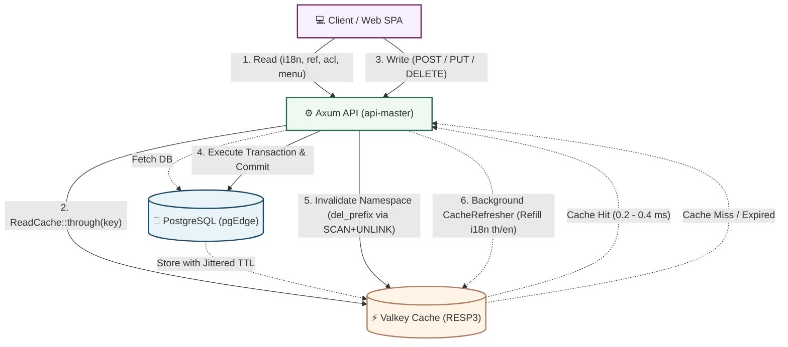

# ⚡ Chapter 11: Valkey Read Cache & Invalidation

> [!info] Navigation
> - ⬅️ Back to: [[10_PROJECT_STRUCTURE_AND_CODE_STYLE|Project Structure & Code Style Guide]]
> - 🧭 [[00_INDEX|Master Index]]

Data that is **read frequently, modified rarely, and shared across users** is cached in Valkey, whereas frequently mutated or strictly real-time data is never cached.
Browsers never communicate with Valkey directly — the API reads through Valkey (cache-aside), and **whenever a write occurs (`POST`/`PUT`/`PATCH`/`DELETE`), the API immediately invalidates and refills affected Valkey namespaces**.

---

## 1. Cache Architecture Flow



---

## 2. Core Components

| Component | Location | Responsibility |
|---|---|---|
| `ReadCache` / `ReadCaches` | `application/core/src/traits/read_cache.rs` | `through(key, ttl, load)`: hit → return from Valkey; miss → load from DB and store; never caches errors; coalesces concurrent loads per key (single-flight); applies ±10% TTL jitter; if Valkey is down or returns corrupt data, falls back to DB transparently without failing the request |
| `CacheService::del_prefix` | `application/core/.../cache.rs`<br>`infrastructure/src/services/cache/del_prefix.rs` | Deletes an entire namespace using `SCAN` + `UNLINK` (non-blocking on the Redis/Valkey event loop) |
| `InMemoryCache` | `application/core/src/traits/memory_cache.rs` | In-memory `CacheService` implementation for unit tests or standalone runs without Valkey |
| `invalidate_cache_on_write` | `infrastructure/src/middleware/cache/cache_invalidation.rs` | Axum middleware: after a successful write request (`2xx`), invalidates namespaces matching the path rules and triggers `CacheRefresher` (rejected `4xx` requests do not invalidate; `5xx` responses invalidate as a precaution against partial mutations) |
| `invalidation_rules()` | `handler/api/master/src/cache_policy.rs` | Mapping table defining which write program/path invalidates which cache namespaces |

> [!TIP] Standard Cache Key Format
> `arch:<namespace>:v1:<th|en|all>:<read_name>:<argument_hash>`
> *(Language is selected from the HTTP request's `Accept-Language` header, except for language-independent namespaces.)*

---

## 3. Cached Namespaces

| Namespace | Cached Data | TTL | Invalidated When Writing To |
|---|---|---|---|
| `acl` | **Per-user access snapshot** (`DbAccessControl`): user record, permission groups + scopes, per-program/action grants — replaces ~6 complex SQL queries on every request | 60 s | `SUPG001`–`SUPG005`, `DBPG003` (deactivating an employee suspends linked user accounts) |
| `menu` | Per-user sidebar navigation tree (`/su/supg002/menu`) | 60 s | Same as `acl` |
| `i18n` | UI translation dictionary + language codes (used by both the web UI and API error templates) + language/category lists (`DBPG006`) | 1 h | `DBPG006` — **refilled immediately in the background** (`th`, `en`) |
| `ref` | System reference data: provinces/districts/sub-districts/postal codes (list, get, summary), master lookups + categories (`DBPG004`), company/branch types, name prefixes | 6 h | `DBPG004`, `DBPG005` |
| `org` | Organization structure options (company/branch/department dropdowns), `DBPG000`–`003` summaries, group/employee/scope options (`SUPG004`) | 5 min | `DBPG000`–`DBPG004`, `SUPG003`, `SUPG004` |
| `programs` | Program option lists (options for `SUPG002`, program filter in `ALPG000`) | 10 min | `SUPG001`, `SUPG002` |
| `dashboard` | System overview KPI summary metrics (`/dashboard/summary`) | 60 s | Any program that mutates counted entities |

---

## 4. Uncached Data & Rationale

> [!IMPORTANT] Data Always Fetched Directly from Database or Stream
> 1. **Audit Logs & Events (Quickwit)**, **Process Monitor (`ALPG001`)**, **My Reports (`RPPG000`)**, **Notifications (`NTPG000`)**: Continually changing state, high-cardinality search parameters, and strict real-time expectations.
> 2. **Master Entity Data Entry**: Primary records opened for editing or paginated search (employees, user accounts, companies/branches/departments) must reflect changes immediately after saving.
> 3. **Complex Per-User Scoped Queries**: The system caches permission grants (`acl`) and lets PostgreSQL apply fine-grained business scope filters.
> 4. **All Mutations & Ephemeral Tokens**: Write operations, pre-signed S3 URLs, verification links, and password recovery tokens.

---

## 5. Write Consistency

1. The write command executes and commits its transaction in PostgreSQL/pgEdge first.
2. The middleware observes a `2xx` response status ➔ invokes `del_prefix("arch:<ns>:")` for every namespace listed in the invalidation policy.
3. `i18n` dictionaries are refilled immediately in the background; other namespaces populate lazily on the next read request (since keys depend on query arguments and cannot all be pre-populated).
4. Every namespace has a bounded TTL as a safety net (e.g., user permissions expire in 60 seconds, so even if cache invalidation fails, revoked permissions cannot persist beyond 60 seconds).

> [!WARNING] Operational Caveats
> - **Out-of-Band Database Writes**: Running seed SQL or batch scripts directly against PostgreSQL does not trigger API cache invalidation. `make seed` automatically runs `make cache-flush`, or you can run `make cache-flush` manually.
> - **Multi-Region Active-Active Environments**: Each region runs its own local Valkey instance. Currently, cross-region consistency relies on TTL expiration; if immediate cross-region invalidation is required, invalidation events can be broadcast over a Redpanda CDC topic.
> - **Short Race Window**: A concurrent read that fetches from the DB just before a commit and writes to the cache just after invalidation may leave a stale entry until TTL expires (which is why `acl` and `menu` use a short 60-second TTL).

---

## 6. Configuration & Operational Commands

- **Disable Read Cache Globally**: Set environment variable `READ_CACHE_ENABLED=false` (if Valkey is unreachable, the API also falls back to PostgreSQL automatically).
- **Inspect All Cached Keys**:
  ```bash
  kubectl -n arch exec deploy/arch-cache -- valkey-cli --scan --pattern 'arch:*'
  ```
- **Flush All Platform Cache Keys**:
  ```bash
  make cache-flush
  ```
- **Add Read Caching to a New Feature**:
  Wrap the query with `caches.ns(cache_ns::<NAMESPACE>).through_key(...)` inside the command executor and register any mutating programs in `cache_policy.rs` (enforced by unit test `test_every_namespace_is_cleared_by_some_write`).

---

## 7. Log Structure & Observability

Cache logs use tracing target `arch::cache` (`api-master` enables `debug` by default in dev):

```text
DEBUG arch::cache: MISS  ref:v1:th:list_provinces:ca92e6285124dfa3 -> database 2.24 ms, stored for 21600 s
DEBUG arch::cache: HIT   ref:v1:th:list_provinces:ca92e6285124dfa3 (0.3 ms)
DEBUG arch::cache: CLEAR i18n: 4 key(s) removed
 INFO arch::cache: WRITE POST /api/v1/db/dbpg006/labels -> 200 : cleared dashboard=1 i18n=2 (refilling in the background)
 INFO arch::cache: REFILL i18n: th (1193 labels), en (1193 labels)
 INFO arch::cache: STATS acl: last 60s hits=390 misses=10 errors=0 ratio=97.5% | since start hits=… misses=… ratio=…
 WARN arch::cache: cache read failed, using the database   (Valkey down: request still succeeds from DB)
```

### Tuning Log Verbosity
| Goal | Environment Variable Configuration |
|---|---|
| Log every HIT / MISS / CLEAR (dev default) | `RUST_LOG="info,api_master=debug,tower_http=info,arch::cache=debug"` |
| Log only write invalidation summaries, flushes, and refills | `RUST_LOG="info,arch::cache=info"` |
| Disable cache logging | `RUST_LOG="info,arch::cache=off"` |
| Periodic STATS summary interval | `CACHE_STATS_SECS=60` (`0` = disable periodic stats) |

---

## 8. Verification Test Suite

- `application/core/tests/read_cache_test.rs`
- `application/master/tests/access_snapshot_test.rs`
- `application/master/tests/cached_localization_test.rs`
- `application/master/tests/dashboard_test.rs`
- `infrastructure/tests/cache_invalidation_test.rs`
- `handler/api/master/tests/cache_policy_test.rs`

---

## 🔗 Cross-Document References
- Technology stack overview and cache ports: [[01_STACK_OVERVIEW|Chapter 1: Tech Stack Overview]]
- Clean Architecture and trait ports: [[02_CLEAN_ARCHITECTURE_RUST|Chapter 2: Clean Architecture in Rust]]
- Multi-region data distribution and caching: [[05_DATA_CONSISTENCY_AND_STORAGE|Chapter 5: Data Consistency & Storage]]
- Network configuration and Valkey port 6379: [[09_NETWORK_PORTS_AND_SECURITY_MATRIX|Chapter 9: Network & Security Matrix]]
- Master index and documentation map: [[00_INDEX|Master Architecture Index]]
