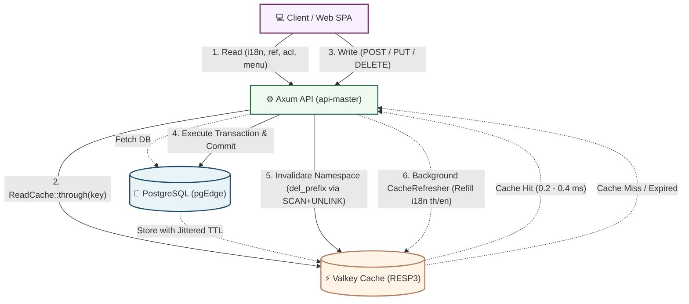

# ⚡ Chapter 11: Valkey Read Cache & Invalidation

> [!info] Navigation
> - ⬅️ Back to: [[10_PROJECT_STRUCTURE_AND_CODE_STYLE|Project Structure & Code Style Guide]]
> - 🧭 [[00_INDEX|Master Index]]

ข้อมูลที่ **อ่านบ่อย แก้น้อย และทุกคนเห็นเหมือนกัน** ถูกเก็บใน Valkey ส่วนข้อมูลที่แก้บ่อย/ต้องสดเสมอไม่แคช
เบราว์เซอร์ไม่คุยกับ Valkey ตรงๆ — API เป็นคนอ่าน (cache-aside) และ**เมื่อมีการเขียน (POST/PUT/PATCH/DELETE) API ล้างและเติมข้อมูลใน Valkey ให้ทันที**

---

## 1. ภาพรวมสถาปัตยกรรมแคช (Cache Architecture Flow)



---

## 2. ส่วนประกอบในระบบ (Core Components)

| ชิ้น | ที่อยู่ | หน้าที่ |
|---|---|---|
| `ReadCache` / `ReadCaches` | `application/core/src/traits/read_cache.rs` | `through(key, ttl, load)`: hit → Valkey, miss → โหลดจาก DB แล้วเก็บ; ไม่แคช error; โหลดครั้งเดียวต่อ key ตอนมีหลาย request พร้อมกัน (single-flight); TTL ±10% (jitter); Valkey ล่ม/คืนค่าเพี้ยน → ข้ามไปอ่าน DB โดยระบบไม่ล่ม |
| `CacheService::del_prefix` | `application/core/.../cache.rs`<br>`infrastructure/src/services/cache/del_prefix.rs` | ลบทั้ง namespace ด้วยคำสั่ง `SCAN` + `UNLINK` (ไม่บล็อก Redis/Valkey event loop) |
| `InMemoryCache` | `application/core/src/traits/memory_cache.rs` | `CacheService` จำลองในหน่วยความจำ สำหรับ unit test หรือรัน standalone โดยไม่ต้องมี Valkey |
| `invalidate_cache_on_write` | `infrastructure/src/middleware/cache_invalidation.rs` | Axum middleware: หลังคำขอเขียนสำเร็จ (2xx) ล้าง namespace ตามกฎของ path นั้น แล้วส่งสัญญาณให้ `CacheRefresher` เติมใหม่ (คำขอที่ถูกปฏิเสธ 4xx ไม่ล้าง; 5xx ล้างเผื่อกรณี partial mutation) |
| `invalidation_rules()` | `handler/api/master/src/cache_policy.rs` | ตาราง Mapping "เขียนที่โปรแกรม/เส้นทางไหน → ล้าง namespace ไหนบ้าง" |

> [!TIP] รูปแบบ Cache Key มาตรฐาน
> `arch:<namespace>:v1:<th|en|all>:<read_name>:<hash ของ argument>`
> *(ภาษาถูกเลือกตาม header `Accept-Language` ของ HTTP request ยกเว้น namespace ที่ไม่ขึ้นกับภาษา)*

---

## 3. ข้อมูลที่อยู่ในแคช (Cached Namespaces)

| Namespace | ข้อมูล | TTL | ถูกล้างเมื่อเขียนที่ใด |
|---|---|---|---|
| `acl` | **snapshot สิทธิ์ต่อผู้ใช้** (`DbAccessControl`): ผู้ใช้, group + scope, grant รายโปรแกรม/action — ทดแทน SQL ซับซ้อน ~6 ตัวต่อทุก request | 60 s | `SUPG001`–`SUPG005`, `DBPG003` (พนักงานถูกปิด → ระงับบัญชีผู้ใช้) |
| `menu` | เมนูฝั่งซ้ายเฉพาะผู้ใช้แต่ละคน (`/su/supg002/menu`) | 60 s | เหมือน `acl` |
| `i18n` | พจนานุกรมคำแปลภาษา + รหัสภาษา (ใช้ทั้งหน้าเว็บและ error templates ของ API) + รายการภาษา/หมวด label (`DBPG006`) | 1 h | `DBPG006` — **เติมใหม่ทันทีใน Background** (`th`, `en`) |
| `ref` | ข้อมูลอ้างอิงระบบ: จังหวัด/อำเภอ/ตำบล/รหัสไปรษณีย์ (list, get, summary), lookup table + หมวด (`DBPG004`), ชนิดบริษัท/สาขา, คำนำหน้าชื่อ | 6 h | `DBPG004`, `DBPG005` |
| `org` | ตัวเลือกโครงสร้างองค์กร (company/branch/department options), summary ของ `DBPG000`–`003`, group/employee/scope options (`SUPG004`) | 5 min | `DBPG000`–`DBPG004`, `SUPG003`, `SUPG004` |
| `programs` | ตัวเลือกรายการโปรแกรม (options สำหรับ `SUPG002`, ตัวกรองโปรแกรมใน `ALPG000`) | 10 min | `SUPG001`, `SUPG002` |
| `dashboard` | ตัวเลขสรุป KPI ภาพรวมระบบ (`/dashboard/summary`) | 60 s | ทุกโปรแกรมที่ส่งผลต่อจำนวนข้อมูลที่ถูกนับ |

---

## 4. ข้อมูลที่ไม่แคช (Uncached Data & Rationale)

> [!IMPORTANT] ขอบเขตที่ต้องดึงจากฐานข้อมูลหรือสตรีมเสมอ
> 1. **Audit Logs & Events (Quickwit)**, **Process Monitor (ALPG001)**, **รายงาน (RPPG000)**, **การแจ้งเตือน (NTPG000)**: ข้อมูลเหล่านี้มีสถานะเปลี่ยนแปลงตลอดเวลา คีย์การค้นหาไม่ซ้ำ และผู้ใช้ต้องการผลลัพธ์ที่สดใหม่ที่สุด
> 2. **Master Entities Data Entry**: ข้อมูลหลักที่ผู้ใช้เปิดเพื่อแก้ไข (ทะเบียนพนักงาน, บัญชีผู้ใช้, ข้อมูลบริษัท/สาขา/แผนก — การค้นหาแบบเจาะจงหรือการแบ่งหน้า) ต้องเห็นผลลัพธ์ทันทีหลังบันทึก
> 3. **ผลลัพธ์ที่ขึ้นกับ Scope ส่วนบุคคลแบบซับซ้อน**: ระบบแคชเฉพาะ "สิทธิ์ (Grants)" แล้วให้ PostgreSQL กรองสโคปตามเงื่อนไขทางธุรกิจ
> 4. **การทำ Mutation ทั้งหมด**: การเขียน, Pre-signed URL, ลิงก์ยืนยันตัวตน หรือ Token สำหรับ Password Reset

---

## 5. ความถูกต้องเมื่อมีการเขียนข้อมูล (Write Consistency)

1. คำสั่งเขียนทำงานและทำการ Commit ที่ PostgreSQL/pgEdge ให้เสร็จสิ้นก่อน
2. Middleware ตรวจพบ Response สถานะสำเร็จ (2xx) ➔ เรียกคำสั่ง `del_prefix("arch:<ns>:")` ของทุก namespace ที่ระบุไว้ในตาราง Invalidation Policy
3. `i18n` จะทำการ Refill พจนานุกรมใหม่ใน Background ทันที; ส่วน namespace อื่นจะเติมข้อมูลอัตโนมัติเมื่อมี Read Request ถัดไปเข้ามา (เนื่องจากคีย์ผูกกับ Arguments จึงไม่สามารถ pre-populate ได้ทั้งหมด)
4. TTL ถูกกำหนดไว้เป็น Safety Net เสมอ (เช่น สิทธิ์ผู้ใช้ 60 วินาที แม้การล้างแคชจะล้มเหลว สิทธิ์ที่ถูกระงับจะคงอยู่ไม่เกิน 60 วินาที)

> [!WARNING] ข้อจำกัดที่ต้องพิจารณา (Operational Caveats)
> - **การแก้ข้อมูลนอก API**: กรณีรัน seed SQL, รัน batch scripts ตรงใน DB ข้อมูลใน Valkey จะไม่ถูกล้างอัตโนมัติ โดย `make seed` จะเรียก `make cache-flush` ให้ หรือสามารถสั่งล้างเองได้ผ่าน `make cache-flush`
> - **สภาพแวดล้อม Multi-Region Active-Active**: แต่ละภูมิภาคมี Valkey ประจำภูมิภาคของตนเอง ปัจจุบันระบบใช้ TTL เป็นเกณฑ์หลัก หากต้องการความสดแบบทันที สามารถส่งสัญญาณล้างข้ามภูมิภาคผ่าน Redpanda CDC Topic ได้
> - **Short Race Window**: Request ที่อ่านข้อมูลจาก DB ก่อนการ Commit เล็กน้อย แล้วนำมาเขียนแคชหลังช่วง Invalidation อาจทำให้มีค่าเก่าค้างอยู่จนหมด TTL (เป็นเหตุผลที่ข้อมูลสิทธิ์และเมนูกำหนด TTL ไว้เพียง 60 วินาที)

---

## 6. การเปิด/ปิด และคำสั่งควบคุม

- **ปิดการใช้งาน Read Cache ทั้งหมด**: ตั้งค่า Environment Variable `READ_CACHE_ENABLED=false` (หรือหาก Valkey ล่ม API จะ Fallback ไปอ่านฐานข้อมูลโดยอัตโนมัติ)
- **ดูคีย์ทั้งหมดที่อยู่ในแคช**:
  ```bash
  kubectl -n arch exec deploy/arch-cache -- valkey-cli --scan --pattern 'arch:*'
  ```
- **ล้างแคชทั้งหมดของระบบ**:
  ```bash
  make cache-flush
  ```
- **การเพิ่ม Read Cache ให้กับ Feature ใหม่**:
  ห่อ Query ด้วย `caches.ns(cache_ns::<NAMESPACE>).through_key(...)` ใน Executor และเพิ่มโปรแกรมที่ทำ Mutation ใน `cache_policy.rs` (มี Unit Test `test_every_namespace_is_cleared_by_some_write` คอยตรวจสอบให้เสมอ)

---

## 7. โครงสร้าง Log และการตรวจสอบ (Observability)

บันทึก Log ของแคชใช้ Target `arch::cache` (api-master เปิดระดับ `debug` เป็นค่าเริ่มต้น):

```text
DEBUG arch::cache: MISS  ref:v1:th:list_provinces:ca92e6285124dfa3 -> database 2.24 ms, stored for 21600 s
DEBUG arch::cache: HIT   ref:v1:th:list_provinces:ca92e6285124dfa3 (0.3 ms)
DEBUG arch::cache: CLEAR i18n: 4 key(s) removed
 INFO arch::cache: WRITE POST /api/v1/db/dbpg006/labels -> 200 : cleared dashboard=1 i18n=2 (refilling in the background)
 INFO arch::cache: REFILL i18n: th (1193 labels), en (1193 labels)
 INFO arch::cache: STATS acl: last 60s hits=390 misses=10 errors=0 ratio=97.5% | since start hits=… misses=… ratio=…
 WARN arch::cache: cache read failed, using the database   (Valkey ล่ม: request ยังตอบจาก DB ได้ตามปกติ)
```

### การปรับแต่งระดับ Log
| ความต้องการ | การตั้งค่า Environment Variable |
|---|---|
| แสดงทุก HIT / MISS / CLEAR (ค่าเริ่มต้นสำหรับ Dev) | `RUST_LOG="info,api_master=debug,tower_http=info,arch::cache=debug"` |
| แสดงเฉพาะสรุปการเขียน ล้าง และ Refill | `RUST_LOG="info,arch::cache=info"` |
| ปิดการแสดง Log ของแคช | `RUST_LOG="info,arch::cache=off"` |
| ความถี่สรุปสถิติ STATS | `CACHE_STATS_SECS=60` (`0` = ปิดการสรุป) |

---

## 8. ชุดทดสอบความถูกต้อง (Test Suite)

- `application/core/tests/read_cache_test.rs`
- `application/master/tests/access_snapshot_test.rs`
- `application/master/tests/cached_localization_test.rs`
- `application/master/tests/dashboard_test.rs`
- `infrastructure/tests/cache_invalidation_test.rs`
- `handler/api/master/tests/cache_policy_test.rs`

---

## 🔗 ความเชื่อมโยงสถาปัตยกรรม (Cross-Document References)
- ภาพรวมเทคโนโลยีและพอร์ตแคช: [[01_STACK_OVERVIEW|Chapter 1: Tech Stack Overview]]
- สถาปัตยกรรม Clean Architecture และ Trait Ports: [[02_CLEAN_ARCHITECTURE_RUST|Chapter 2: Clean Architecture in Rust]]
- การกระจายข้อมูลและแคชหลาย Region: [[05_DATA_CONSISTENCY_AND_STORAGE|Chapter 5: Data Consistency & Storage]]
- การตั้งค่า Network และพอร์ต Valkey 6379: [[09_NETWORK_PORTS_AND_SECURITY_MATRIX|Chapter 9: Network & Security Matrix]]
- ดัชนีหลักและแผนผังเอกสาร: [[00_INDEX|Master Architecture Index]]
