# 📑 Program Catalogue & Screen Specifications (MOC)

แผนผังหน้าจอและข้อกำหนดการทำงานของโปรแกรมทั้งหมดในระบบ อ้างอิงตามทะเบียนโปรแกรมใน [`sql/52_program_catalogue.sql`](file:///home/attaporn_j/Desktop/work/research/rust_arch_clean/sql/52_program_catalogue.sql) 

เอกสารชุดนี้จัดทำขึ้นเพื่อให้พร้อมสำหรับเปิดใน **Obsidian** สามารถคลิกดูแต่ละหน้าจอเพื่อเขียน **Scope & Business Requirements** เพิ่มเติมได้ทันที

---

## 🗂️ ภาพรวมโครงสร้างระบบ (System Hierarchy)

```mermaid
graph TD
    ROOT["🖥️ ERP Clean Architecture Application"]
    
    ROOT --> SY["System: SY (ระบบงานทั่วไป / System Core)"]
    ROOT --> DB["System: DB (ข้อมูลหลัก / Master Data)"]
    ROOT --> SU["System: SU (ความปลอดภัย / Security & IAM)"]
    ROOT --> AL["System: AL (ตรวจสอบ / Audit Log)"]

    SY --> SYMT["Module: SYMT"]
    SYMT --> SYPG000["[[SYPG000_DASHBOARD|SYPG000 - ภาพรวมระบบ (Dashboard)]]"]

    DB --> DBMT["Module: DBMT"]
    DBMT --> DBPG000["[[DBPG000_ORGANIZATIONS_MAIN|DBPG000 - หน้าหลักองค์กรและบริษัท]]"]
    DBPG000 -.->|Sub-routes /ORG & /COMPANY| DBPG001["[[DBPG001_ORGANIZATIONS|DBPG001 - Detail องค์กร/บริษัท]]"]
    DBMT --> DBPG002["[[DBPG002_BRANCHES_DEPARTMENTS|DBPG002 - กำหนดสาขา / แผนก]]"]
    DBMT --> DBPG003["[[DBPG003_EMPLOYEES|DBPG003 - ทะเบียนพนักงาน]]"]
    DBMT --> DBPG004["[[DBPG004_REFERENCE_DATA|DBPG004 - ข้อมูลอ้างอิงระบบ]]"]
    DBMT --> DBPG005["[[DBPG005_GEOGRAPHY|DBPG005 - จังหวัด / อำเภอ / ตำบล]]"]
    DBMT --> DBPG006["[[DBPG006_I18N_LABELS|DBPG006 - ข้อความแปลภาษา]]"]

    SU --> SUMT["Module: SUMT"]
    SUMT --> SUPG000["Folder: SUPG000 (กำหนดสิทธิ์)"]
    SUPG000 --> SUPG001["[[SUPG001_SYSTEMS_MODULES|SUPG001 - จัดการระบบ / โมดูล]]"]
    SUPG000 --> SUPG002["[[SUPG002_MENUS_PROGRAMS|SUPG002 - จัดการเมนู]]"]
    SUPG000 --> SUPG003["[[SUPG003_PERMISSION_MATRIX|SUPG003 - แฟ้มสิทธิ์การเข้าใช้งาน]]"]
    SUPG000 --> SUPG004["[[SUPG004_USER_ACCOUNTS|SUPG004 - กำหนดผู้ใช้งาน]]"]
    SUPG000 --> SUPG005["[[SUPG005_IAM_SESSION|SUPG005 - สถานะเซสชัน (IAM)]]"]

    AL --> ALMT["Module: ALMT"]
    ALMT --> ALPG000_GROUP["Folder: ALPG000_GROUP (ตรวจสอบ)"]
    ALPG000_GROUP --> ALPG000["[[ALPG000_AUDIT_LOG|ALPG000 - บันทึกการตรวจสอบ]]"]
    ALPG000_GROUP --> ALPG001["[[ALPG001_PROCESS_MONITOR|ALPG001 - ติดตามกระบวนการ]]"]
    ALMT --> RPPG000["[[RPPG000_MY_REPORTS|RPPG000 - รายงานของฉัน]]"]
    ALMT --> NTPG000["[[NTPG000_NOTIFICATIONS|NTPG000 - การแจ้งเตือน]]"]
```

---

## 📋 สารบัญหน้าจอแยกตามโมดูล (Screen Directory)

### 1. System: `SY` (ระบบ / System Core)
| รหัสโปรแกรม | Route Path | ชื่อภาษาไทย | Title (EN) | ไอคอน | สถานะ Scope | ลิงก์เอกสาร |
|---|---|---|---|---|---|---|
| **`SYPG000`** | `/` | ภาพรวมระบบ | Dashboard | `DashboardOutlined` | 🟡 รอระบุ Scope | [[SYPG000_DASHBOARD]] |

### 2. System: `DB` (ข้อมูลหลัก / Master Data)
| รหัสโปรแกรม | Route Path | ชื่อภาษาไทย | Title (EN) | ไอคอน | สถานะ Scope | ลิงก์เอกสาร |
| **`DBPG000`** | `/db/dbpg000` | หน้าหลักองค์กรและบริษัท | Organizations & Companies (Main) | `ApartmentOutlined` | 🟢 Implemented (พัฒนาแล้วเสร็จ) | [[DBPG000_ORGANIZATIONS_MAIN]] |
| ↳ **`DBPG001`** | `/db/dbpg001/org` `/db/dbpg001/company` | จัดการข้อมูลองค์กร/บริษัท (Detail) | Organizations & Companies (Detail) | `ApartmentOutlined` | 🟢 Implemented (พัฒนาแล้วเสร็จ) | [[DBPG001_ORGANIZATIONS]] |
| **`DBPG002`** | `/db/dbpg002` | กำหนดสาขา / แผนก | Branches & Departments | `BankOutlined` | 🟢 Implemented (พัฒนาแล้วเสร็จ) | [[DBPG002_BRANCHES_DEPARTMENTS]] |
| **`DBPG003`** | `/db/dbpg003` | ทะเบียนพนักงาน | Employees | `IdcardOutlined` | 🟢 Implemented (พัฒนาแล้วเสร็จ) | [[DBPG003_EMPLOYEES]] |
| **`DBPG004`** | `/db/dbpg004` | ข้อมูลอ้างอิงระบบ | Reference Data | `GroupOutlined` | 🟢 Implemented (พัฒนาแล้วเสร็จ) | [[DBPG004_REFERENCE_DATA]] |
| **`DBPG005`** | `/db/dbpg005` | จังหวัด / อำเภอ / ตำบล | Geography | `GlobalOutlined` | 🟢 Implemented (พัฒนาแล้วเสร็จ) | [[DBPG005_GEOGRAPHY]] |
| **`DBPG006`** | `/db/dbpg006` | ข้อความแปลภาษา | i18n Labels | `TranslationOutlined` | 🟢 Implemented (พัฒนาแล้วเสร็จ) | [[DBPG006_I18N_LABELS]] |

### 3. System: `SU` (ความปลอดภัยและผู้ใช้งาน / Security & IAM)
| รหัสโปรแกรม | Route Path | ชื่อภาษาไทย | Title (EN) | ไอคอน | สถานะ Scope | ลิงก์เอกสาร |
|---|---|---|---|---|---|---|
| **`SUPG001`** | `/su/supg001` | จัดการระบบ / โมดูล | Systems & Modules | `ClusterOutlined` | 🟢 Implemented (พัฒนาแล้วเสร็จ) | [[SUPG001_SYSTEMS_MODULES]] |
| **`SUPG002`** | `/su/supg002` | จัดการเมนู | Menus & Programs | `MenuOutlined` | 🟢 Implemented (พัฒนาแล้วเสร็จ) | [[SUPG002_MENUS_PROGRAMS]] |
| **`SUPG003`** | `/su/supg003` | แฟ้มสิทธิ์การเข้าใช้งาน | Permission Matrix | `SafetyOutlined` | 🟢 Implemented (พัฒนาแล้วเสร็จ) | [[SUPG003_PERMISSION_MATRIX]] |
| **`SUPG004`** | `/su/supg004` | กำหนดผู้ใช้งาน | User Accounts | `UserOutlined` | 🟢 Implemented (พัฒนาแล้วเสร็จ) | [[SUPG004_USER_ACCOUNTS]] |
| **`SUPG005`** | `/su/supg005` | สถานะเซสชัน (IAM) | IAM & Session Monitor | `SafetyCertificateOutlined` | 🟢 Implemented (พัฒนาแล้วเสร็จ) | [[SUPG005_IAM_SESSION]] |

### 4. System: `AL` (ตรวจสอบระบบ / Audit & Compliance)
| รหัสโปรแกรม | Route Path | ชื่อภาษาไทย | Title (EN) | ไอคอน | สถานะ Scope | ลิงก์เอกสาร |
|---|---|---|---|---|---|---|
| **`ALPG000`** | `/al/alpg000` | บันทึกการตรวจสอบ | Audit Log | `FileSearchOutlined` | 🟢 Implemented (พัฒนาแล้วเสร็จ) | [[ALPG000_AUDIT_LOG]] |
| **`ALPG001`** | `/al/alpg001` | ติดตามกระบวนการ | Process Monitor | `SyncOutlined` | 🟢 Implemented (พัฒนาแล้วเสร็จ) | [[ALPG001_PROCESS_MONITOR]] |
| **`RPPG000`** | `/rp/rppg000` | รายงานของฉัน | My Reports | `FileDoneOutlined` | 🟢 Implemented (พัฒนาแล้วเสร็จ) | [[RPPG000_MY_REPORTS]] |
| **`NTPG000`** | `/nt/ntpg000` | การแจ้งเตือน | Notifications | `BellOutlined` | 🟢 Implemented (พัฒนาแล้วเสร็จ) | [[NTPG000_NOTIFICATIONS]] |

---

## 🔗 ความเชื่อมโยงสถาปัตยกรรม (Architecture Cross-References)
- สถาปัตยกรรม Clean Architecture ใน Rust: [[02_CLEAN_ARCHITECTURE_RUST|Clean Architecture Spec]]
- การจัดการสิทธิ์และความปลอดภัย: [[06_SECURITY_IDENTITY_AUTH|Security & IAM Spec]]
- โมเดลฐานข้อมูลและการจัดการ Master Lookup: [[05_DATA_CONSISTENCY_AND_STORAGE|Data Consistency Spec]]
- ดัชนีหลักและค้นหาเอกสาร: [[00_INDEX|Master Architecture Index]]
