# 📑 Program Catalogue & Screen Specifications (MOC)

Map of all screens and functional specifications across the platform, matching the program catalogue defined in [`sql/52_program_catalogue.sql`](file:///home/attaporn_j/Desktop/work/research/rust_arch_clean/sql/52_program_catalogue.sql).

This documentation suite is structured for **Obsidian** so you can navigate directly to any screen to review or extend its **Scope & Business Requirements**.

---

## 🗂️ System Hierarchy

```mermaid
graph TD
    ROOT["🖥️ ERP Clean Architecture Application"]
    
    ROOT --> SY["System: SY (System Core)"]
    ROOT --> DB["System: DB (Master Data)"]
    ROOT --> SU["System: SU (Security & IAM)"]
    ROOT --> AL["System: AL (Audit & Compliance)"]

    SY --> SYMT["Module: SYMT"]
    SYMT --> SYPG000["[[SYPG000_DASHBOARD|SYPG000 - Dashboard]]"]

    DB --> DBMT["Module: DBMT"]
    DBMT --> DBPG000["[[DBPG000_ORGANIZATIONS_MAIN|DBPG000 - Organizations & Companies (Main)]]"]
    DBPG000 -.->|Sub-routes /ORG & /COMPANY| DBPG001["[[DBPG001_ORGANIZATIONS|DBPG001 - Organization / Company Detail]]"]
    DBMT --> DBPG002["[[DBPG002_BRANCHES_DEPARTMENTS|DBPG002 - Branches & Departments]]"]
    DBMT --> DBPG003["[[DBPG003_EMPLOYEES|DBPG003 - Employees]]"]
    DBMT --> DBPG004["[[DBPG004_REFERENCE_DATA|DBPG004 - Reference Data]]"]
    DBMT --> DBPG005["[[DBPG005_GEOGRAPHY|DBPG005 - Geography]]"]
    DBMT --> DBPG006["[[DBPG006_I18N_LABELS|DBPG006 - i18n Labels]]"]

    SU --> SUMT["Module: SUMT"]
    SUMT --> SUPG000["Folder: SUPG000 (Security & Permissions)"]
    SUPG000 --> SUPG001["[[SUPG001_SYSTEMS_MODULES|SUPG001 - Systems & Modules]]"]
    SUPG000 --> SUPG002["[[SUPG002_MENUS_PROGRAMS|SUPG002 - Menus & Programs]]"]
    SUPG000 --> SUPG003["[[SUPG003_PERMISSION_MATRIX|SUPG003 - Permission Matrix]]"]
    SUPG000 --> SUPG004["[[SUPG004_USER_ACCOUNTS|SUPG004 - User Accounts]]"]
    SUPG000 --> SUPG005["[[SUPG005_IAM_SESSION|SUPG005 - IAM & Session Monitor]]"]
    SUPG000 --> SUPG006["[[SUPG006_SECURITY_MAIL_SETTINGS|SUPG006 - Security & Mail Settings]]"]

    AL --> ALMT["Module: ALMT"]
    ALMT --> ALPG000_GROUP["Folder: ALPG000_GROUP (Audit)"]
    ALPG000_GROUP --> ALPG000["[[ALPG000_AUDIT_LOG|ALPG000 - Audit Log]]"]
    ALPG000_GROUP --> ALPG001["[[ALPG001_PROCESS_MONITOR|ALPG001 - Process Monitor]]"]
    ALMT --> RPPG000["[[RPPG000_MY_REPORTS|RPPG000 - My Reports]]"]
    ALMT --> NTPG000["[[NTPG000_NOTIFICATIONS|NTPG000 - Notifications]]"]
```

---

## 📋 Screen Directory by Module

### 1. System: `SY` (System Core)
| Program Code | Route Path | Title (EN) | Icon | Scope Status | Spec Link |
|---|---|---|---|---|---|
| **`SYPG000`** | `/` | Dashboard | `DashboardOutlined` | 🟡 Pending Scope | [[SYPG000_DASHBOARD]] |

### 2. System: `DB` (Master Data)
| Program Code | Route Path | Title (EN) | Icon | Scope Status | Spec Link |
|---|---|---|---|---|---|
| **`DBPG000`** | `/db/dbpg000` | Organizations & Companies (Main) | `ApartmentOutlined` | 🟢 Implemented | [[DBPG000_ORGANIZATIONS_MAIN]] |
| ↳ **`DBPG001`** | `/db/dbpg001/org` `/db/dbpg001/company` | Organizations & Companies (Detail) | `ApartmentOutlined` | 🟢 Implemented | [[DBPG001_ORGANIZATIONS]] |
| **`DBPG002`** | `/db/dbpg002` | Branches & Departments | `BankOutlined` | 🟢 Implemented | [[DBPG002_BRANCHES_DEPARTMENTS]] |
| **`DBPG003`** | `/db/dbpg003` | Employees | `IdcardOutlined` | 🟢 Implemented | [[DBPG003_EMPLOYEES]] |
| **`DBPG004`** | `/db/dbpg004` | Reference Data | `GroupOutlined` | 🟢 Implemented | [[DBPG004_REFERENCE_DATA]] |
| **`DBPG005`** | `/db/dbpg005` | Geography | `GlobalOutlined` | 🟢 Implemented | [[DBPG005_GEOGRAPHY]] |
| **`DBPG006`** | `/db/dbpg006` | i18n Labels | `TranslationOutlined` | 🟢 Implemented | [[DBPG006_I18N_LABELS]] |

### 3. System: `SU` (Security & IAM)
| Program Code | Route Path | Title (EN) | Icon | Scope Status | Spec Link |
|---|---|---|---|---|---|
| **`SUPG001`** | `/su/supg001` | Systems & Modules | `ClusterOutlined` | 🟢 Implemented | [[SUPG001_SYSTEMS_MODULES]] |
| **`SUPG002`** | `/su/supg002` | Menus & Programs | `MenuOutlined` | 🟢 Implemented | [[SUPG002_MENUS_PROGRAMS]] |
| **`SUPG003`** | `/su/supg003` | Permission Matrix | `SafetyOutlined` | 🟢 Implemented | [[SUPG003_PERMISSION_MATRIX]] |
| **`SUPG004`** | `/su/supg004` | User Accounts | `UserOutlined` | 🟢 Implemented | [[SUPG004_USER_ACCOUNTS]] |
| **`SUPG005`** | `/su/supg005` | IAM & Session Monitor | `SafetyCertificateOutlined` | 🟢 Implemented | [[SUPG005_IAM_SESSION]] |
| **`SUPG006`** | `/su/supg006` | Security & Mail Settings | `LockOutlined` | 🟢 Implemented | [[SUPG006_SECURITY_MAIL_SETTINGS]] |

### 4. System: `AL` (Audit & Compliance)
| Program Code | Route Path | Title (EN) | Icon | Scope Status | Spec Link |
|---|---|---|---|---|---|
| **`ALPG000`** | `/al/alpg000` | Audit Log | `FileSearchOutlined` | 🟢 Implemented | [[ALPG000_AUDIT_LOG]] |
| **`ALPG001`** | `/al/alpg001` | Process Monitor | `SyncOutlined` | 🟢 Implemented | [[ALPG001_PROCESS_MONITOR]] |
| **`RPPG000`** | `/rp/rppg000` | My Reports | `FileDoneOutlined` | 🟢 Implemented | [[RPPG000_MY_REPORTS]] |
| **`NTPG000`** | `/nt/ntpg000` | Notifications | `BellOutlined` | 🟢 Implemented | [[NTPG000_NOTIFICATIONS]] |

---

## 🔗 Architecture Cross-References
- Clean Architecture in Rust: [[02_CLEAN_ARCHITECTURE_RUST|Clean Architecture Spec]]
- Identity, Authentication & Permissions: [[06_SECURITY_IDENTITY_AUTH|Security & IAM Spec]]
- Database Model & Master Lookup Management: [[05_DATA_CONSISTENCY_AND_STORAGE|Data Consistency Spec]]
- Master Architecture Index & Search Matrix: [[00_INDEX|Master Architecture Index]]
