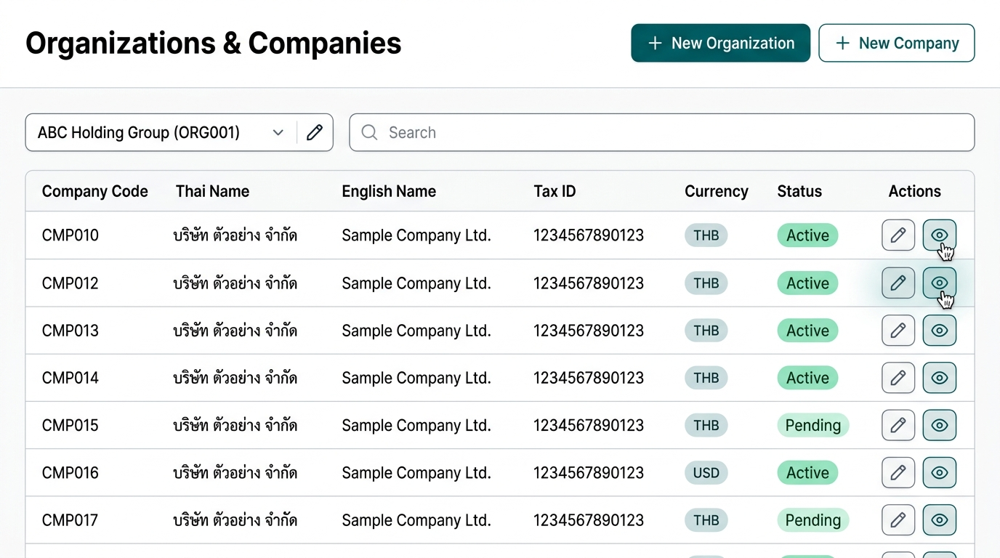
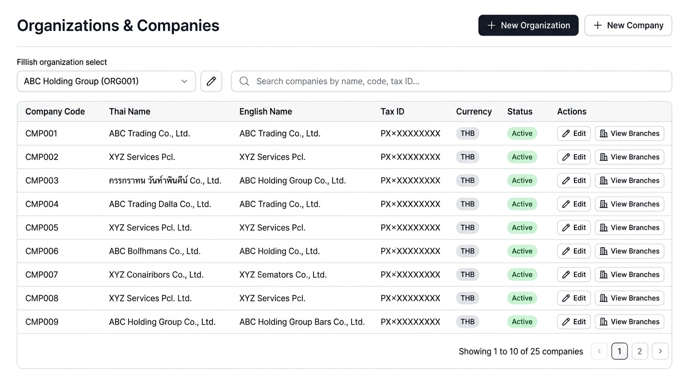

# 🏢 DBPG000 - Organizations & Companies (Main Screen)

> [!INFO] **Program Metadata**
> - **Program Code**: `DBPG000`
> - **Title (EN)**: Organizations & Companies (Main Screen)
> - **Route Path**: `/db/dbpg000`
> - **Icon**: `ApartmentOutlined` (`icondata_ai`)
> - **System**: `DB` (Database)
> - **Module**: `DBMT` (Master Data)
> - **Detail Sub-pages**:
>   - [[DBPG001_ORGANIZATIONS#page-1-dbdbpg001org-organization-management-org|/db/dbpg001/org (Create / Edit Organization)]]
>   - [[DBPG001_ORGANIZATIONS#page-2-dbdbpg001company-company-management-company|/db/dbpg001/company (Create / Edit Company)]]
> - **Backlink**: [[00_INDEX|Back to Program Catalogue (MOC)]]

---

## 🎯 1. Screen Overview
Central hub for searching and managing organizations and affiliated companies (Organizations & Companies Dashboard), consisting of:
1. **Organization Selector Dropdown (Select Org)** to filter companies belonging to a specific corporate group.
2. **Real-Time Company Search Bar** for filtering companies across multiple fields.
3. **Company Data Table** displaying status, primary currency, and registration/tax identifiers.
4. **Action Buttons** navigating to two dedicated detail screens:
   - `/db/dbpg001/org` to Create / Update an Organization
   - `/db/dbpg001/company` to Create / Update a Company

---

## 🖼️ 2. UI Mockup & Wireframe

### 2.1 Modern Teal Theme UI Mockup (shadcn/ui OKLCH)


### 2.2 Neutral Theme Mockup


### 2.3 ASCII Layout Wireframe
```
+----------------------------------------------------------------------------------------------------+
|  🏢 Organizations & Companies                                           [+ Add Org] [+ Add Company] |
+----------------------------------------------------------------------------------------------------+
|  [ 🏢 Organization: [ ABC Holding Co., Ltd. (ORG001)              ▼ ] ] [ ✏️ Edit Org ]             |
|                                                                                                    |
|  🔍 Search Company: [ Type company name, code, or registration number...                       🔍 ] |
+----------------------------------------------------------------------------------------------------+
|  Companies                                                                        Found 3 companies |
+------------+---------------------------+-----------------------+-------------+----------+---------+--------+
| Code       | Company Name (TH)         | Company Name (EN)     | (Tax ID in contacts)   | Currency| Status | Actions|
+------------+---------------------------+-----------------------+-------------+----------+---------+--------+
| CMP001     | ABC Trading (TH)          | ABC Trading Co., Ltd. | 01055500001 | THB (฿)  | Active  | [✏️] [👁️] |
| CMP002     | ABC Logistics (TH)        | ABC Logistics Ltd.    | 01055500002 | THB (฿)  | Active  | [✏️] [👁️] |
| CMP003     | ABC Digital Solutions (TH)| ABC Digital Solutions | 01055500003 | THB (฿)  | Inactive| [✏️] [👁️] |
+------------+---------------------------+-----------------------+-------------+----------+---------+--------+
|  [ ◀ Page 1 of 1 ▶ ]                                                         Show [ 10 ▼ ] per page |
+----------------------------------------------------------------------------------------------------+
```

---

## 📝 3. Scope & Requirements

### 3.1 Screen Components
1. **Header Actions**:
   - `[+ Add Organization]` -> Navigates to `/db/dbpg001/org` (Create mode).
   - `[+ Add Company]` -> Navigates to `/db/dbpg001/company` (Create mode, pre-selecting `org_id` from the current dropdown selection).

2. **Org Selector Dropdown**:
   - Fetches organizations from `db_organization` + `db_organization_label` (filtered to `active = true`).
   - Display format: `<Organization Name> (<Code>)`.
   - Default first option: `All Organizations` to view companies across all corporate groups.
   - `[✏️ Edit Org]` button next to the dropdown: navigates to `/db/dbpg001/org/{selected_org_id}` to edit the selected organization immediately.

3. **Company Search Bar**:
   - Debounced typeahead search (300ms).
   - Supports cross-language partial matching on:
     - Company code (`db_company.code`)
     - Thai company name (`db_company_label.label` TH)
     - English company name (`db_company_label.label` EN)
     - Registration number (`db_company.registration_number`)

4. **Company Data Table**:
   - **Table Columns**:
     - `Code`
     - `Company Name (TH)`
     - `Company Name (EN)`
     - `Parent Organization` (shown when viewing All Organizations)
     - `Company Type`
     - `Primary Currency` (e.g. `THB`, `USD`)
     - `Status` (Active / Inactive badge)
     - `Actions`:
       - ✏️ **Edit**: Navigates to `/db/dbpg001/company/{company_id}`
       - 👁️ **Branches**: Shortcut to view branches of this company in [[DBPG002_BRANCHES_DEPARTMENTS|DBPG002]] (`/db/dbpg002?company_id={company_id}`)

### 3.2 Business Rules
- **Data Visibility Scope**: Users only see companies permitted by their View Scope (`ViewScope` middleware based on home branch and `su_user_assignment` scopes — see [[12_VIEW_SCOPE_COMPANY_SWITCHER]]).
- **Pagination & Sorting**: Supports server-side pagination (10, 25, 50 rows per page) and sorting by company code or name.

---

## 🔗 4. Linked Detail Sub-Pages
- 📄 **[[DBPG001_ORGANIZATIONS#page-1-dbdbpg001org-organization-management-org|/db/dbpg001/org]]**: Create / Update Organization screen
- 📄 **[[DBPG001_ORGANIZATIONS#page-2-dbdbpg001company-company-management-company|/db/dbpg001/company]]**: Create / Update Company screen

---

## 🔒 5. Permissions & Security
The API enforces program permissions for `DBPG000` on every endpoint (behind Ory Kratos session authentication):
- **`READ`** = View / Search: Required for all `GET` endpoints (organizations list/detail, companies list/detail, company types, KPI summary). Because this screen is opened via the `DBPG001` sidebar menu entry, the API accepts `READ` on **either** `DBPG000` **or** `DBPG001`.
- **`WRITE`** = Create / Edit: `DBPG000` is a read-only overview screen; mutations are handled by `DBPG001`.
- **`APPROVE`** = Delete: No delete endpoints exist on `DBPG000` (deletion is handled in `DBPG001`).
- Missing permission => HTTP 403 `FORBIDDEN`.

---

## 💻 6. Clean Architecture Implementation
- **Frontend SPA (Leptos 0.8 CSR WebAssembly)**:
  - Route: `/organization` (and alias `/db/dbpg000`)
  - Page Entry: [`handler/web/application/master/src/pages/db/dbpg000/mod.rs`](file:///home/attaporn_j/Desktop/work/research/rust_arch_clean/handler/web/application/master/src/pages/db/dbpg000/mod.rs) (`Dbpg000Page`)
  - Screen Orchestrator: [`handler/web/application/master/src/pages/db/dbpg000/screens/dbpg000_screen.rs`](file:///home/attaporn_j/Desktop/work/research/rust_arch_clean/handler/web/application/master/src/pages/db/dbpg000/screens/dbpg000_screen.rs)
  - Components:
    - [`org_stats_cards.rs`](file:///home/attaporn_j/Desktop/work/research/rust_arch_clean/handler/web/application/master/src/pages/db/dbpg000/components/org_stats_cards.rs): KPI summary cards for total organizations and active/inactive companies
    - [`org_selector_bar.rs`](file:///home/attaporn_j/Desktop/work/research/rust_arch_clean/handler/web/application/master/src/pages/db/dbpg000/components/org_selector_bar.rs): Organization selector dropdown + Add Org / Edit Org / Add Company buttons
    - [`company_search_filter.rs`](file:///home/attaporn_j/Desktop/work/research/rust_arch_clean/handler/web/application/master/src/pages/db/dbpg000/components/company_search_filter.rs): Multi-dimensional real-time search + Active/Inactive status filter chips
    - [`company_data_table.rs`](file:///home/attaporn_j/Desktop/work/research/rust_arch_clean/handler/web/application/master/src/pages/db/dbpg000/components/company_data_table.rs): Company data table with logos, codes, Thai/English names, parent org, company type, status, edit action, and branches shortcut
  - Provider & Context: [`providers/dbpg000_context.rs`](file:///home/attaporn_j/Desktop/work/research/rust_arch_clean/handler/web/application/master/src/pages/db/dbpg000/providers/dbpg000_context.rs) (manages reactive state and error signals)
  - Empty State UI: Renders an empty table state ("No companies found" with a "+ Add Company" button) and an inline warning banner when the database is unreachable rather than a full-screen 503 error page.
- **Backend API Delivery Tier (Axum 0.8)**:
  - Router: [`handler/api/master/src/routers/dbpg000_router.rs`](file:///home/attaporn_j/Desktop/work/research/rust_arch_clean/handler/api/master/src/routers/dbpg000_router.rs)
  - Endpoints:
    - `GET /api/v1/db/dbpg000/organizations` (list organizations with localized labels and company counts)
    - `GET /api/v1/db/dbpg000/organizations/{id}` (get single organization)
    - `GET /api/v1/db/dbpg000/organizations/summary` (get overall KPI statistics)
    - `GET /api/v1/db/dbpg000/companies` (list companies filtered by organization, search query, status, and pagination)
    - `GET /api/v1/db/dbpg000/companies/{id}` (get single company)
    - `GET /api/v1/db/dbpg000/companies/types` (list legal entity types from `db_master_lookup`)
- **Application CQRS Layer (`application-master`)**:
  - Feature: [`application/master/src/features/db/dbpg000/`](file:///home/attaporn_j/Desktop/work/research/rust_arch_clean/application/master/src/features/db/dbpg000/)
  - Trait Commands: `OrganizationCommands` & Executor: `OrganizationCommandExecutor`
  - Trait Queries: `OrganizationQueries` & Runner: `DbOrganizationQueries` (Sea-ORM 2.0)
  - Models & DTOs: `models/mod.rs`
  - Errors: `errors/mod.rs` (`OrganizationError`)
- **Domain Entities Layer (`domain`)**:
  - `domain::entity::db_organization`
  - `domain::entity::db_organization_label`
  - `domain::entity::db_company`
  - `domain::entity::db_company_label`
  - `domain::entity::db_master_lookup`
  - `domain::entity::db_master_lookup_label`
