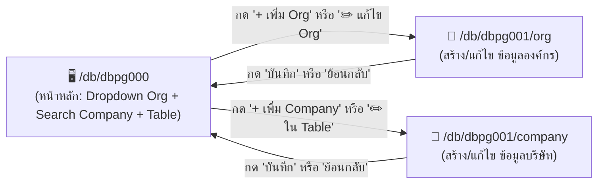

# 🏢 DBPG001 - จัดการองค์กรและบริษัท (Detail Pages)

> [!INFO] **ข้อมูลโปรแกรม (Program Metadata)**
> - **Program Code**: `DBPG001`
> - **ชื่อภาษาไทย**: จัดการข้อมูลองค์กรและบริษัท (หน้า Detail)
> - **Title (EN)**: Organizations & Companies Details
> - **Parent Main Screen**: [[DBPG000_ORGANIZATIONS_MAIN|/db/dbpg000 (หน้าหลักองค์กรและบริษัท)]]
> - **Detail Sub-Routes**:
>   1. **`/db/dbpg001/org`**: สร้างและแก้ไขข้อมูลองค์กร (Organization)
>   2. **`/db/dbpg001/company`**: สร้างและแก้ไขข้อมูลบริษัท (Company)
> - **Icon**: `ApartmentOutlined` (`icondata_ai`)
> - **System**: `DB` (ฐานข้อมูล / Database) | **Module**: `DBMT` (ข้อมูลหลัก / Master Data)
> - **Backlink**: [[00_INDEX|กลับสู่สารบัญโปรแกรม (MOC)]]

---

## 🎯 ภาพรวมโครงสร้าง Route
โปรแกรมนี้ทำหน้าที่เป็น **Detail & Form Views** ของ [[DBPG000_ORGANIZATIONS_MAIN|DBPG000]]:


---

## 📄 หน้า 1: `/db/dbpg001/org` (จัดการองค์กร - ORG)
ใช้สำหรับ **Create** (สร้างองค์กรใหม่) และ **Update** (แก้ไขข้อมูลองค์กรเดิม เช่น `/db/dbpg001/org/{org_id}`)

### 1.1 Wireframe & Form Layout
```
+----------------------------------------------------------------------------------------------------+
|  🏢 [ ◀ ย้อนกลับ ] กำหนดองค์กร (Organization Form)                             [ ยกเลิก ] [ บันทึก ] |
+----------------------------------------------------------------------------------------------------+
|  ข้อมูลทั่วไป (General Information)                                                                 |
|  * รหัสองค์กร (Code):        [ ORG001             ]   สถานะ: [X] เปิดใช้งาน (Active)                 |
|  * ชื่อองค์กร (ภาษาไทย):     [ บริษัท เอบีซี โฮลดิ้ง จำกัด                                       ] |
|  * ชื่อองค์กร (English):     [ ABC Holding Co., Ltd.                                            ] |
+----------------------------------------------------------------------------------------------------+
|  ที่อยู่สำนักงานใหญ่ (Head Office Address)                                                          |
|  เลขที่/อาคาร/ถนน:           [ 123 อาคารเอบีซี ทาวเวอร์ ชั้น 20 ถนนสุขุมวิท                       ] |
|  ประเทศ: [ ประเทศไทย (TH) ▼ ]  จังหวัด: [ กรุงเทพมหานคร ▼ ]  อำเภอ/เขต: [ วัฒนา ▼ ]               |
|  ตำบล/แขวง: [ คลองเตยเหนือ ▼ ]  รหัสไปรษณีย์: [ 10110      ]                                       |
+----------------------------------------------------------------------------------------------------+
|  ข้อมูลติดต่อ (Contact Information)                                                                 |
|  เบอร์โทรศัพท์: [ 02-123-4567         ]  อีเมลกลาง: [ contact@abcholding.com                   ] |
|  เว็บไซต์:      [ https://www.abcholding.com                                                    ] |
+----------------------------------------------------------------------------------------------------+
```

### 1.2 ฟิลด์และ Validation Rules (ORG)
| ฟิลด์ | ตาราง / คอลัมน์ | ชนิดข้อมูล | เงื่อนไข (Validation) |
|---|---|---|---|
| **รหัสองค์กร** | `db_organization.code` | `VARCHAR(100)` | Required, Unique, ตัวพิมพ์ใหญ่, ห้ามเว้นวรรค |
| **ชื่อไทย** | `db_organization_label.label` (TH) | `VARCHAR(255)` | Required, ภาษาไทย |
| **ชื่ออังกฤษ** | `db_organization_label.label` (EN) | `VARCHAR(255)` | Required, ภาษาอังกฤษ |
| **สถานะ** | `db_organization.active` | `BOOLEAN` | Default: `true` |
| **ที่อยู่** | `db_address` | Address FK | เชื่อมโยงกับ [[DBPG005_GEOGRAPHY|เขตภูมิศาสตร์]] |
| **ช่องทางติดต่อ**| `db_contact` | Contact FK | โทรศัพท์, อีเมล, เว็บไซต์ |

---

## 📄 หน้า 2: `/db/dbpg001/company` (จัดการบริษัท - COMPANY)
ใช้สำหรับ **Create** (สร้างบริษัทใหม่) และ **Update** (แก้ไขข้อมูลบริษัท เช่น `/db/dbpg001/company/{company_id}`)

### 2.1 Wireframe & Form Layout
```
+----------------------------------------------------------------------------------------------------+
|  🏬 [ ◀ ย้อนกลับ ] ข้อมูลบริษัทในเครือ (Company Form)                         [ ยกเลิก ] [ บันทึก ] |
+----------------------------------------------------------------------------------------------------+
|  สังกัดองค์กร (Parent Organization)                                                                |
|  * องค์กรแม่ (Organization): [ บริษัท เอบีซี โฮลดิ้ง จำกัด (ORG001)                           ▼ ] |
+----------------------------------------------------------------------------------------------------+
|  ข้อมูลนิติบุคคล (Company Details)                                                                 |
|  * รหัสบริษัท (Code):        [ CMP001             ]   สถานะ: [X] เปิดใช้งาน (Active)                 |
|  * ชื่อบริษัท (ภาษาไทย):     [ บริษัท เอบีซี เทรดดิ้ง จำกัด                                      ] |
|  * ชื่อบริษัท (English):     [ ABC Trading Co., Ltd.                                            ] |
|  ช่องทางติดต่อ/Tax ID: ดูส่วน "ช่องทางติดต่อและเลขประจำตัว" ท้ายฟอร์ม      * สกุลเงินหลัก: [ THB - บาทไทย (฿)       ▼ ] |
|  ทะเบียนการค้า (Reg No):     [ 01055500001        ]                                                |
+----------------------------------------------------------------------------------------------------+
|  ที่อยู่จดทะเบียน (Registered Address)                                                             |
|  เลขที่/อาคาร/ถนน:           [ 99/1 ถนนสีลม แขวงสีลม                                            ] |
|  ประเทศ: [ ประเทศไทย (TH) ▼ ]  จังหวัด: [ กรุงเทพมหานคร ▼ ]  อำเภอ/เขต: [ บางรัก ▼ ]              |
|  ตำบล/แขวง: [ สีลม ▼ ]        รหัสไปรษณีย์: [ 10500      ]                                       |
+----------------------------------------------------------------------------------------------------+
|  ข้อมูลติดต่อ (Contact Information)                                                                 |
|  เบอร์โทรศัพท์: [ 02-987-6543         ]  อีเมล: [ info@abctrading.com                          ] |
+----------------------------------------------------------------------------------------------------+
```

### 2.2 ฟิลด์และ Validation Rules (COMPANY)
| ฟิลด์ | ตาราง / คอลัมน์ | ชนิดข้อมูล | เงื่อนไข (Validation) |
|---|---|---|---|
| **องค์กรแม่** | `db_company.organization_id` | `UUID` | Required, ต้องเลือกจาก Dropdown องค์กรที่ active |
| **รหัสบริษัท** | `db_company.code` | `VARCHAR(100)` | Required, Unique ภายใต้องค์กรเดียวกัน |
| **ชื่อไทย** | `db_company_label.label` (TH) | `VARCHAR(255)` | Required |
| **ชื่ออังกฤษ** | `db_company_label.label` (EN) | `VARCHAR(255)` | Required |
| **Tax ID** | ช่องทางติดต่อชนิด `TAX_ID` (`db_contact`) | — | ไม่ใช่คอลัมน์ของบริษัท: กรอกในส่วน "ช่องทางติดต่อและเลขประจำตัว" ของฟอร์ม (ดูหัวข้อ Contacts ด้านล่าง) |
| **สกุลเงิน** | `db_company.currency_id` | `UUID` | Required, ผูกกับ `db_currency` |
| **สถานะ** | `db_company.active` | `BOOLEAN` | Default: `true` |

---

## 🔒 สิทธิ์และความปลอดภัย (Permissions & Audit)
- **`su_permission`** (ตรวจที่ฝั่ง API ทุก endpoint ของโปรแกรม `DBPG001`; ไม่มีสิทธิ์ => HTTP 403 `FORBIDDEN`):
  - `READ` = ดู/ค้นหา: ทุก GET (รายการ/รายละเอียดองค์กรและบริษัท, ประเภทบริษัท)
  - `WRITE` = เพิ่ม/แก้ไข: POST และ PUT ทั้ง ORG และ COMPANY
  - `APPROVE` = ลบ: DELETE องค์กร/บริษัท (การลบเป็นการกระทำที่ทำลายข้อมูล จึงต้องมีสิทธิ์อนุมัติ)
- **Audit Logging**:
  - เมื่อบันทึกสำเร็จ ระบบยิง Kafka Event เข้าสู่ Redpanda เพื่อบันทึก Snapshot ก่อน-หลัง (Diff) เข้า Quickwit ทันที

---

## 💻 Clean Architecture Implementation
- **Frontend SPA (หน้าแยก `/db/dbpg001/org[/{id}]` และ `/db/dbpg001/company[/{id}]`)**:
  - Page Entry: [`pages/db/dbpg001/mod.rs`](file:///home/attaporn_j/Desktop/work/research/rust_arch_clean/handler/web/application/master/src/pages/db/dbpg001/mod.rs) (`Dbpg001OrgPage`, `Dbpg001CompanyPage`)
  - Screens: [`dbpg001_org_screen.rs`](file:///home/attaporn_j/Desktop/work/research/rust_arch_clean/handler/web/application/master/src/pages/db/dbpg001/screens/dbpg001_org_screen.rs), [`dbpg001_company_screen.rs`](file:///home/attaporn_j/Desktop/work/research/rust_arch_clean/handler/web/application/master/src/pages/db/dbpg001/screens/dbpg001_company_screen.rs)
  - Forms: [`org_form.rs`](file:///home/attaporn_j/Desktop/work/research/rust_arch_clean/handler/web/application/master/src/pages/db/dbpg001/components/org_form.rs), [`company_form.rs`](file:///home/attaporn_j/Desktop/work/research/rust_arch_clean/handler/web/application/master/src/pages/db/dbpg001/components/company_form.rs)
  - Context: [`providers/dbpg001_context.rs`](file:///home/attaporn_j/Desktop/work/research/rust_arch_clean/handler/web/application/master/src/pages/db/dbpg001/providers/dbpg001_context.rs) (โหลดเรคอร์ด + ส่ง `row_version` ที่โหลดมาตอนบันทึก)
  - Route table: [`routes/master_routes.rs`](file:///home/attaporn_j/Desktop/work/research/rust_arch_clean/handler/web/application/master/src/routes/master_routes.rs), path constants: [`routes/program_paths.rs`](file:///home/attaporn_j/Desktop/work/research/rust_arch_clean/handler/web/application/master/src/routes/program_paths.rs)
- **Backend API (Axum 0.8)** — base `/api/v1/db/dbpg001`:
  - `GET /organizations` (ตัวเลือกองค์กรแม่), `GET /organizations/{id}`, `POST /organizations`, `PUT /organizations/{id}`
  - `GET /companies/types`, `GET /companies/{id}`, `POST /companies`, `PUT /companies/{id}`
  - **โลโก้ / รูปภาพ** (`image_key` บน `db_organization` / `db_company`, ไฟล์อยู่ใน Garage S3 ที่ `images/<organizations|companies>/{id}/<uuidv7>.<ext>`):
    `GET|PUT|DELETE /organizations/{id}/image` และ `/companies/{id}/image` — `PUT` รับไฟล์ดิบเป็น body (Content-Type `image/*`), ตอบ DTO ที่มี `image_url`; `GET` ตอบไบต์ของรูป (`nosniff`, `private` cache) ใช้สิทธิ์ `DBPG001` Read หรือ `DBPG000` Read, `PUT`/`DELETE` ต้อง Write
    - รับเฉพาะ **PNG / JPEG / GIF / WebP ไม่เกิน 2 MB** ตัดสินจากไบต์แรกของไฟล์ (ไม่เชื่อ Content-Type ที่ client อ้าง) — **ไม่รับ SVG** เพราะฝัง script ได้
    - อัปโหลดใหม่จะลบไฟล์เก่า, ลบ org/company จะลบไฟล์ด้วย; ไม่เพิ่ม `row_version` (ฟอร์มที่เปิดค้างยังบันทึกได้); URL มี `?v=<uuid ของไฟล์>` กัน browser ใช้รูปเก่า
    - **แบรนด์ที่ sidebar**: มุมซ้ายบนแสดงโลโก้ + ชื่อองค์กร และชื่อบริษัทเป็นบรรทัดรอง ของ**พนักงานที่บัญชีผู้ใช้ผูกอยู่** (`su_user.employee_id` → `db_employee.organization_id` / `company_id`) มาจาก `GET /api/v1/access/me` (`organization`, `company`) ชื่อตามภาษาที่เลือก; ไม่มีโลโก้แสดงตัวอักษรแรก; บัญชีที่ไม่มีพนักงาน/องค์กรใช้แบรนด์ของแอปตามเดิม; ทุกบัญชีดูโลโก้ของ org/company ตัวเองได้โดยไม่ต้องมีสิทธิ์ Read
    - เว็บ: คอมโพเนนต์ `ImageField` (`web_package::ui::component`) ในฟอร์ม org/company (พนักงานใช้ตัวเดียวกัน ดู DBPG003; ตัวเก็บรูปกลาง `application/master/src/features/db/image_object_store.rs`) (ต้องบันทึกก่อนจึงเพิ่มรูปได้) และโลโก้ในตารางบริษัทของ DBPG000
  - **Contacts** (`GET|PUT /organizations/{id}/contacts`, `/companies/{id}/contacts`; ฟอร์มสาขาและพนักงานใช้แบบเดียวกันที่ `/db/dbpg002/branches/{id}/contacts`, `/db/dbpg003/employees/{id}/contacts`): โทรศัพท์ โทรสาร อีเมล ไลน์ **เลขประจำตัวผู้เสียภาษี (Tax ID)** ของนิติบุคคล/สาขา และ **เลขบัตรประชาชน** ของพนักงาน เก็บเป็นรายการใน contact group ของแถวนั้น (`contact_group_id` → `db_contact` ชนิดจาก lookup `contact_type`: `PHONE FAX EMAIL LINE TAX_ID ID_CARD`) `PUT` แทนที่ทั้งรายการ (ไม่เพิ่ม `row_version`) กฎ: `TAX_ID` เฉพาะ org/company/branch, `ID_CARD` เฉพาะพนักงาน, อีเมล/เบอร์โทรตรวจรูปแบบ, ซ้ำไม่ได้, ชนิดละ 1 ค่าหลัก (`default_contact`; ไม่ระบุ = รายการแรกของชนิด), ไม่เกิน 30 รายการ; อ่านต้อง Read ของโปรแกรม เขียนต้อง Write (พนักงาน: ตามขอบเขตแผนก) และอยู่ในขอบเขตการมองเห็น (ไม่งั้น 404) ฟอร์มส่งรายการพร้อมการกดบันทึกข้อมูล (`ContactsEditor` ใน `web_package`); ลบ org/company/พนักงาน/สาขาจะลบ contact group ด้วย
  - **`registration_number`** คือเลขทะเบียนที่องค์กรลงทะเบียนกับ**ระบบนี้** ไม่ใช่เลขทะเบียนนิติบุคคล/Tax ID (Tax ID เป็น contact ชนิด `TAX_ID`)
  - `DELETE /organizations/{id}`, `DELETE /companies/{id}` (204): ลบจริงเฉพาะเมื่อไม่มีข้อมูลอื่นอ้างอิง (ลบ label ของแถวนั้นใน transaction เดียวกัน) มิฉะนั้นตอบ 409 `IN_USE` → ให้ปิดการใช้งาน (Active) แทน
  - Production-Ready: ยิงไปยัง Axum REST API จริง ไม่มีการจำลองผลลัพธ์เทียม (Mock Success) หากมีข้อผิดพลาดจะแจ้งเตือนผู้ใช้ทันที
  - Router: [`dbpg001_router.rs`](file:///home/attaporn_j/Desktop/work/research/rust_arch_clean/handler/api/master/src/routers/dbpg001_router.rs)
- **Application CQRS Layer**: [`features/db/dbpg001/`](file:///home/attaporn_j/Desktop/work/research/rust_arch_clean/application/master/src/features/db/dbpg001/)
  - Executor: [`dbpg001_executor.rs`](file:///home/attaporn_j/Desktop/work/research/rust_arch_clean/application/master/src/features/db/dbpg001/commands/dbpg001_executor.rs)
  - Commands: `CreateOrganizationCommand`, `UpdateOrganizationCommand`, `CreateCompanyCommand`, `UpdateCompanyCommand`
  - Optimistic Lock Check: `row_version` matching
- **Domain Entities**:
  - `domain::entity::db_organization`
  - `domain::entity::db_organization_label`
  - `domain::entity::db_company`
  - `domain::entity::db_company_label`
  - `domain::entity::db_master_lookup`
