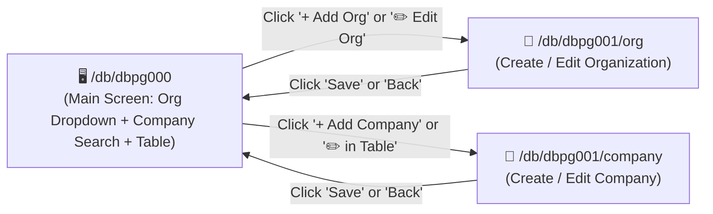

# 🏢 DBPG001 - Organizations & Companies (Detail Pages)

> [!INFO] **Program Metadata**
> - **Program Code**: `DBPG001`
> - **Title (EN)**: Organizations & Companies Details
> - **Parent Main Screen**: [[DBPG000_ORGANIZATIONS_MAIN|/db/dbpg000 (Organizations & Companies Main Screen)]]
> - **Detail Sub-Routes**:
>   1. **`/db/dbpg001/org`**: Create and update an Organization
>   2. **`/db/dbpg001/company`**: Create and update a Company
> - **Icon**: `ApartmentOutlined` (`icondata_ai`)
> - **System**: `DB` (Database) | **Module**: `DBMT` (Master Data)
> - **Backlink**: [[00_INDEX|Back to Program Catalogue (MOC)]]

---

## 🎯 Route Flow Overview
This program provides the **Detail & Form Views** for [[DBPG000_ORGANIZATIONS_MAIN|DBPG000]]:


---

## 📄 Page 1: `/db/dbpg001/org` (Organization Management - ORG)
Used to **Create** a new organization or **Update** an existing organization (`/db/dbpg001/org/{org_id}`).

### 1.1 Wireframe & Form Layout
```
+----------------------------------------------------------------------------------------------------+
|  🏢 [ ◀ Back ] Organization Form                                                [ Cancel ] [ Save ] |
+----------------------------------------------------------------------------------------------------+
|  General Information                                                                               |
|  * Organization Code:        [ ORG001             ]   Status: [X] Active                           |
|  * Organization Name (TH):   [ ABC Holding (TH)                                                  ] |
|  * Organization Name (EN):   [ ABC Holding Co., Ltd.                                             ] |
+----------------------------------------------------------------------------------------------------+
|  Head Office Address                                                                               |
|  Street / Building:          [ 123 ABC Tower, 20th Fl., Sukhumvit Rd.                            ] |
|  Country: [ Thailand (TH) ▼ ]  Province: [ Bangkok ▼ ]           District: [ Watthana ▼ ]          |
|  Sub-District: [ Khlong Toei Nuea ▼ ]  Postal Code: [ 10110      ]                                 |
+----------------------------------------------------------------------------------------------------+
|  Contacts & Identifiers                                                                            |
|  Phone:   [ 02-123-4567         ]  Email:   [ contact@abcholding.com                             ] |
|  Tax ID:  [ 0105550000001       ]                                                                  |
+----------------------------------------------------------------------------------------------------+
```

### 1.2 Fields & Validation Rules (ORG)
| Field | Table / Column | Type | Validation Rules |
|---|---|---|---|
| **Organization Code** | `db_organization.code` | `VARCHAR(100)` | Required, Unique, uppercase, no whitespace |
| **Thai Name** | `db_organization_label.label` (TH) | `VARCHAR(255)` | Required |
| **English Name** | `db_organization_label.label` (EN) | `VARCHAR(255)` | Required |
| **Status** | `db_organization.active` | `BOOLEAN` | Default: `true` |
| **Address** | `db_address` | Address FK | Linked to [[DBPG005_GEOGRAPHY|Geography]] |
| **Contacts** | `db_contact` | Contact FK | Phone, Fax, Email, LINE, Tax ID |

---

## 📄 Page 2: `/db/dbpg001/company` (Company Management - COMPANY)
Used to **Create** a new company or **Update** an existing company (`/db/dbpg001/company/{company_id}`).

### 2.1 Wireframe & Form Layout
```
+----------------------------------------------------------------------------------------------------+
|  🏬 [ ◀ Back ] Company Form                                                     [ Cancel ] [ Save ] |
+----------------------------------------------------------------------------------------------------+
|  Parent Organization                                                                               |
|  * Organization:             [ ABC Holding Co., Ltd. (ORG001)                                  ▼ ] |
+----------------------------------------------------------------------------------------------------+
|  Company Details                                                                                   |
|  * Company Code:             [ CMP001             ]   Status: [X] Active                           |
|  * Company Name (TH):        [ ABC Trading (TH)                                                  ] |
|  * Company Name (EN):        [ ABC Trading Co., Ltd.                                             ] |
|  Contacts / Tax ID: see "Contacts & Identifiers" section below  * Currency: [ THB - Thai Baht ▼ ] |
|  System Reg No:              [ 01055500001        ]                                                |
+----------------------------------------------------------------------------------------------------+
|  Registered Address                                                                                |
|  Street / Building:          [ 99/1 Silom Rd., Silom                                             ] |
|  Country: [ Thailand (TH) ▼ ]  Province: [ Bangkok ▼ ]           District: [ Bang Rak ▼ ]          |
|  Sub-District: [ Silom ▼ ]             Postal Code: [ 10500      ]                                 |
+----------------------------------------------------------------------------------------------------+
|  Contacts & Identifiers                                                                            |
|  Phone:   [ 02-987-6543         ]  Email:   [ info@abctrading.com                                ] |
+----------------------------------------------------------------------------------------------------+
```

### 2.2 Fields & Validation Rules (COMPANY)
| Field | Table / Column | Type | Validation Rules |
|---|---|---|---|
| **Parent Organization** | `db_company.organization_id` | `UUID` | Required, must reference an active organization |
| **Company Code** | `db_company.code` | `UUID` / `VARCHAR(100)` | Required, Unique within the same parent organization |
| **Thai Name** | `db_company_label.label` (TH) | `VARCHAR(255)` | Required |
| **English Name** | `db_company_label.label` (EN) | `VARCHAR(255)` | Required |
| **Tax ID** | Contact of type `TAX_ID` (`db_contact`) | — | Stored in the company's contact group under "Contacts & Identifiers" (not a column on `db_company`; see Contacts section below) |
| **Currency** | `db_company.currency_id` | `UUID` | Required, references `db_currency` |
| **Status** | `db_company.active` | `BOOLEAN` | Default: `true` |

---

## 🔒 Permissions & Audit
- **`su_permission`** (enforced on every API endpoint of `DBPG001`; missing permission => HTTP 403 `FORBIDDEN`):
  - `READ` = View / Search: all `GET` endpoints (organization/company details, parent org options, company types)
  - `WRITE` = Create / Update: `POST` and `PUT` for both ORG and COMPANY
  - `APPROVE` = Delete: `DELETE` organization or company (destructive operation requiring approval permission)
- **Audit Logging**:
  - Every mutation is captured by the PostgreSQL `al_capture_change` trigger and shipped to Quickwit with full before/after snapshots.

---

## 💻 Clean Architecture Implementation
- **Frontend SPA (dedicated routes `/db/dbpg001/org[/{id}]` and `/db/dbpg001/company[/{id}]`)**:
  - Page Entry: [`pages/db/dbpg001/mod.rs`](file:///home/attaporn_j/Desktop/work/research/rust_arch_clean/handler/web/application/master/src/pages/db/dbpg001/mod.rs) (`Dbpg001OrgPage`, `Dbpg001CompanyPage`)
  - Screens: [`dbpg001_org_screen.rs`](file:///home/attaporn_j/Desktop/work/research/rust_arch_clean/handler/web/application/master/src/pages/db/dbpg001/screens/dbpg001_org_screen.rs), [`dbpg001_company_screen.rs`](file:///home/attaporn_j/Desktop/work/research/rust_arch_clean/handler/web/application/master/src/pages/db/dbpg001/screens/dbpg001_company_screen.rs)
  - Forms: [`org_form.rs`](file:///home/attaporn_j/Desktop/work/research/rust_arch_clean/handler/web/application/master/src/pages/db/dbpg001/components/org_form.rs), [`company_form.rs`](file:///home/attaporn_j/Desktop/work/research/rust_arch_clean/handler/web/application/master/src/pages/db/dbpg001/components/company_form.rs)
  - Context: [`providers/dbpg001_context.rs`](file:///home/attaporn_j/Desktop/work/research/rust_arch_clean/handler/web/application/master/src/pages/db/dbpg001/providers/dbpg001_context.rs) (loads records and passes the loaded `row_version` when saving)
  - Route table: [`routes/master_routes.rs`](file:///home/attaporn_j/Desktop/work/research/rust_arch_clean/handler/web/application/master/src/routes/master_routes.rs), path constants: [`routes/program_paths.rs`](file:///home/attaporn_j/Desktop/work/research/rust_arch_clean/handler/web/application/master/src/routes/program_paths.rs)
- **Backend API (Axum 0.8)** — base `/api/v1/db/dbpg001`:
  - `GET /organizations` (parent organization options), `GET /organizations/{id}`, `POST /organizations`, `PUT /organizations/{id}`
  - `GET /companies/types`, `GET /companies/{id}`, `POST /companies`, `PUT /companies/{id}`
  - **Logos / Images** (`image_key` on `db_organization` / `db_company`, stored in Garage S3 at `images/<organizations|companies>/{id}/<uuidv7>.<ext>`):
    `GET|PUT|DELETE /organizations/{id}/image` and `/companies/{id}/image` — `PUT` accepts raw image bytes (`Content-Type: image/*`) and returns a DTO containing `image_url`; `GET` streams the image bytes (`nosniff`, `private` cache) and requires `DBPG001` `READ` or `DBPG000` `READ`, while `PUT`/`DELETE` require `WRITE`.
    - Accepts only **PNG / JPEG / GIF / WebP up to 2 MB**, verified by inspecting magic bytes (never trusting client `Content-Type`) — **SVG is rejected** because it can embed scripts.
    - Uploading a new image deletes the previous S3 object, and deleting an org/company deletes its image as well; image uploads do not increment `row_version` (so an open form can still save without version conflict); image URLs append `?v=<file_uuid>` for cache busting.
    - **Sidebar Branding**: The top-left sidebar header displays the organization logo + name and company subtitle belonging to **the employee linked to the signed-in user account** (`su_user.employee_id` → `db_employee.organization_id` / `company_id`), returned by `GET /api/v1/access/me` (`organization`, `company`) in the active language; falls back to an initial-letter avatar if no logo is set, or to the default platform brand if the account has no linked employee/organization; every authenticated user can fetch their own organization/company logo without needing `DBPG000`/`DBPG001` `READ` permission.
    - Web UI: `ImageField` component (`web_package::ui::component`) in the org/company forms (shared with employee photos in `DBPG003`; backed by `application/master/src/features/db/image_object_store.rs`; record must be saved before uploading an image) and company logo avatars in the `DBPG000` table.
  - **Contacts** (`GET|PUT /organizations/{id}/contacts`, `/companies/{id}/contacts`; also used by branch and employee forms at `/db/dbpg002/branches/{id}/contacts` and `/db/dbpg003/employees/{id}/contacts`): Phone, Fax, Email, LINE, **Tax ID** (for organizations/companies/branches), and **National ID Card** (for employees) are stored in the entity's contact group (`contact_group_id` → `db_contact` with type from master lookup `contact_type`: `PHONE`, `FAX`, `EMAIL`, `LINE`, `TAX_ID`, `ID_CARD`). `PUT` replaces the entire contact list (without incrementing `row_version`). Validation rules: `TAX_ID` is allowed only on org/company/branch, `ID_CARD` only on employee; email and phone formats are validated; duplicate entries are rejected; at most one primary contact (`default_contact`) per contact type (defaults to the first entry of that type if unspecified); maximum 30 contacts per entity. Reading requires `READ` permission on the program, writing requires `WRITE` (scoped by department for employees), and the entity must be within the user's View Scope (otherwise `404`). Forms submit contacts alongside the main save action via `ContactsEditor` (`web_package`); deleting an org/company/branch/employee also deletes its contact group.
  - **`registration_number`** is the internal registration number assigned to the organization/company within **this platform**, not the government corporate registration / Tax ID (which is stored as a `TAX_ID` contact).
  - `DELETE /organizations/{id}`, `DELETE /companies/{id}` (`204 No Content`): permanently deletes the record and its labels in a single transaction if unreferenced; if referenced by child records, returns `409 IN_USE` (deactivate the record instead).
  - Router: [`dbpg001_router.rs`](file:///home/attaporn_j/Desktop/work/research/rust_arch_clean/handler/api/master/src/routers/dbpg001_router.rs)
- **Application CQRS Layer**: [`features/db/dbpg001/`](file:///home/attaporn_j/Desktop/work/research/rust_arch_clean/application/master/src/features/db/dbpg001/)
  - Executor: [`dbpg001_executor.rs`](file:///home/attaporn_j/Desktop/work/research/rust_arch_clean/application/master/src/features/db/dbpg001/commands/dbpg001_executor.rs)
  - Commands: `CreateOrganizationCommand`, `UpdateOrganizationCommand`, `CreateCompanyCommand`, `UpdateCompanyCommand`
  - Optimistic Lock Check: `row_version` — updated via `update_versioned` (`UPDATE … WHERE id AND row_version = <loaded_version>`; mismatch → `412 VERSION_CONFLICT`), writing main row and labels within a single transaction.
- **Domain Entities**:
  - `domain::entity::db_organization`
  - `domain::entity::db_organization_label`
  - `domain::entity::db_company`
  - `domain::entity::db_company_label`
  - `domain::entity::db_master_lookup`
